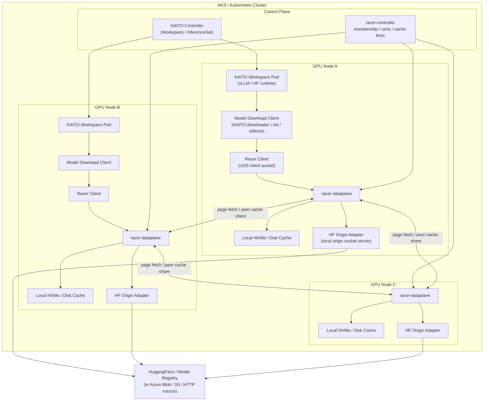
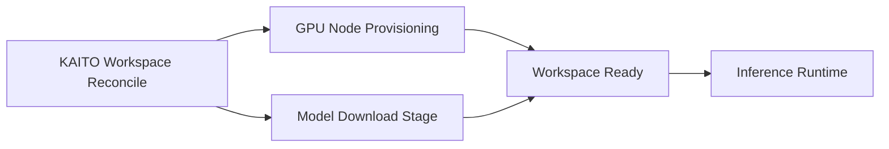
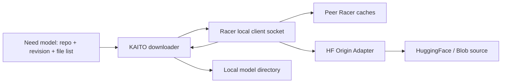

# KAITO 场景下的 Racer 集成架构图

## 结论

对于 KAITO 的模型下载场景，**Racer 最适合放在“模型下载分发层”**，而不是一开始就深度耦合进推理 runtime 的文件访问路径。

更具体地说：

- **推理运行时** 仍然从本地模型目录读取权重
- **模型下载阶段** 通过 Racer 做跨节点共享缓存、去重下载、降低源站压力
- Racer 主要解决的是：**多个节点/Pod 并发下载同一模型时的集群级分发与缓存复用问题**

---

## 一、KAITO + Racer 集成架构图



---

## 二、各组件在 KAITO 里的含义

### 1. KAITO Workspace Pod

这是最终承载推理服务的 Pod，里面可能运行：

- vLLM runtime
- HuggingFace runtime
- 未来其他推理引擎

它本身不一定直接感知 Racer；更自然的方式是让它依赖一个“模型下载阶段”。

### 2. Model Download Client

这是最关键的集成点。它可以是：

- init container
- sidecar downloader
- Pod 启动时执行的下载脚本
- 独立的 model-download service

这个组件负责：

- 请求模型文件
- 通过 Racer 拉取文件内容
- 将最终文件落到本地模型目录

### 3. Racer Client

下载器不再直接访问 HuggingFace，而是先走本地 Racer client socket。

好处是：

- 本地命中时无需回源
- 本地 miss 时可向其他节点拉缓存页
- 只有真正全局 miss 时才访问源站

### 4. racer-dataplane

每个参与节点一个 dataplane，负责：

- 本地内存/磁盘缓存
- 跨节点 page 拉取
- owner 选择与 page 分发
- 必要时调用本地 origin 回源

### 5. HF Origin Adapter

这是 Racer 在 KAITO 场景下最关键的一层自定义适配。

它需要把 Racer 的对象请求转换成：

- HuggingFace 下载请求
- HTTP range 请求
- 或未来 Azure Blob / S3 / 企业内部模型仓访问请求

从职责上看，它相当于：

> **Racer 与外部模型源之间的协议转换层。**

### 6. Local NVMe / Disk Cache

GPU 节点通常带本地 NVMe，这正适合 Racer：

- 首次下载时缓存模型权重页
- 后续节点可以复用
- 节省远端带宽与下载时间

这和 KAITO “优先利用 GPU 节点本地盘作为模型存储”的方向也是一致的。

---

## 三、模型下载路径怎么走

## 场景 A：冷启动，集群里没人有这个模型

流程如下：

1. KAITO 创建 Workspace，触发模型下载
2. 下载器通过 Racer client socket 请求模型文件
3. 本地 dataplane miss
4. dataplane 查询 owner 节点，也 miss
5. owner 调用本机的 HF Origin Adapter
6. Origin Adapter 去 HuggingFace 拉取对象 range
7. 数据按 page 进入 Racer cache
8. 数据返回给下载器
9. 下载器把文件落到 Workspace 使用的本地模型目录

这个流程的核心价值是：

- 只让少数必要请求真正打到源站
- 同时把下载内容缓存到集群内可复用的位置

---

## 场景 B：第二个 Pod / 第二个节点再拉同一个模型

流程如下：

1. 新 Pod 发起相同模型读取
2. 本地 dataplane miss
3. 但其他节点已有对应 page
4. 本地 dataplane 直接从 peer 节点拉取 page
5. 不再重复访问 HuggingFace
6. 下载更快，源站压力更小

这就是 Racer 在 KAITO 场景中的核心收益：

- 避免每个节点重复下载完整模型
- 加快横向扩容与滚动重建时的模型预热
- 降低 HuggingFace 或企业模型仓的突发读取压力

---

## 四、推荐的 KAITO 集成方式

## 推荐方式：只在“下载阶段”接入 Racer

这是我最建议的方式：

- **下载阶段**：走 Racer
- **推理阶段**：直接读本地模型目录

这样做有几个明显好处：

### 1. 对 KAITO 改动最小

不需要强行让 vLLM/HF runtime 直接理解 Racer 协议或 Unix socket。

### 2. 故障域更清晰

- 下载失败是下载链路问题
- 推理运行时仍然走成熟的本地文件路径

这样排障会简单很多。

### 3. 更符合 KAITO 现有心智模型

KAITO 现在本来就有比较明确的：

- 节点准备
- 模型准备
- Workspace 就绪
- 推理服务启动

Racer 非常适合落在“模型准备”阶段。

### 4. 降低运行时复杂度

推理路径上少一层动态分布式依赖，稳定性更高。

---

## 五、按 KAITO 生命周期拆分

下面这个图更贴近 KAITO 的整体工作流：



其中最值得单独设计的是 `Model Download Stage`：



这个图表达的意思是：

> **Racer 放在下载器和源站之间，负责去重、缓存和跨节点共享；下载器仍然对本地模型目录负责。**

---

## 六、对象 key 设计建议

如果真的在 KAITO 里落地 Racer，不建议用“模型名”这种弱 key，而应该用稳定内容标识。

建议 key 组成至少包含：

- `model_repo`
- `revision`
- `filename`
- `etag` 或内容摘要（如 `sha256`）

例如：

```text
key = sha256(repo + revision + filename + etag)
```

这样可以避免：

- 同模型不同 revision 互相污染
- 同名文件内容变化导致命中错误缓存
- 灰度/回滚时复用到错误版本

对大模型权重场景，这是必须做严谨的地方。

---

## 七、这版架构图背后的判断

这套设计的核心判断可以概括成一句话：

> **Racer 在 KAITO 里最适合做“模型下载分发层”，而不是“推理读路径重构层”。**

因此它最自然的位置应该在：

- `HuggingFace / Blob / HTTP source`
- 和 `KAITO model downloader`

之间。

而不建议一开始就强耦合进：

- vLLM runtime 的 mmap/read 路径
- HuggingFace runtime 的本地文件访问模型
- 推理阶段的每次文件 I/O

这样可以让架构边界更清晰，也更容易先做出一个可演进版本。

---

## 八、最终建议

如果要在 KAITO 里试 Racer，我建议按下面路线推进：

1. **先把 Racer 用在模型下载阶段**
2. **实现 HuggingFace Origin Adapter**
3. **把下载结果仍然落到本地模型目录**
4. **先优化冷启动和多节点重复下载问题**
5. **后续再评估是否需要更深层 runtime 集成**

这样收益最大、风险最可控，也最符合 KAITO 当前的架构形态。
