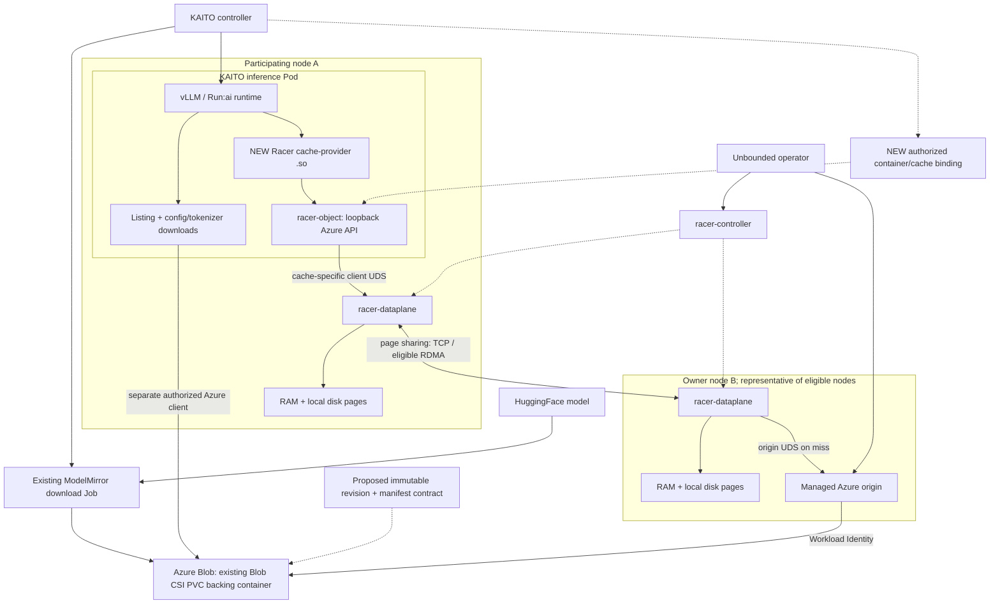

# Racer + KAITO 模型分发与流式加载设计

> 状态：设计提案，尚未完成端到端实现或性能验证。更新：2026-10-24。
> 范围：AKS 上 KAITO 推理工作负载的模型准备与启动加速；第一阶段以 Azure Blob 中的不可变模型为源。
> 本文补充 [KAITO + Racer 架构概览](./kaito-racer-integration-architecture.md)，区分已有上游能力与待开发组件。涉及主干能力时必须核对实际部署版本，不能仅凭主干代码认定运行镜像已支持。

## 1. 设计结论

**以 KAITO 现有 Model Mirror + Model Streaming 为主路径，将 Racer 作为 Model Streaming 下方的可选分布式 read-through cache。** 三者是叠加关系，不另建一套 Model Mirror，也不要求普通用户手动拼装缓存组件。职责分离：

- KAITO：选择模型、创建推理 Pod、配置模型加载方式、控制就绪与发布。
- Racer：跨节点共享对象页、合并部分重复读取、管理本地内存与磁盘缓存、在 miss 时回源。
- 模型发布流程：生成不可变模型目录及 manifest，保证配置文件、分片索引和权重属于同一 revision。
- Runtime：继续负责 safetensors 解析、tensor/GPU 加载和推理，不承担缓存节点调度。

支持两条接入路线，不能混为一个已经存在的产品功能：

| 路线 | 数据路径 | 适用场景 | 待开发部分 |
|---|---|---|---|
| A：下载后本地加载 | Racer → downloader → 本地完整模型目录 → runtime | 优先兼容现有 runtime、希望模型准备完成后解除缓存依赖 | manifest-aware downloader、完整性检查和原子发布 |
| B：流式加载 | Racer → cache-provider `.so` → Run:ai Model Streamer → GPU | 已使用 Azure Blob + Run:ai/vLLM 流式加载，希望避免每个 Pod 保存完整权重 | Racer-backed provider、镜像打包、版本一致性和故障测试 |

**主方案为路线 B：保留现有 ModelMirror、Blob CSI PVC、GPU provisioning 和 Run:ai streaming，在 native range read 路径增加 Racer provider。** 路线 A 降为非 streaming runtime 的备选，不改变现有 streaming 用户默认不完整落盘权重的行为。不应在没有基准测试时宣称 B 一定更快，也不应把两条路线叠加成默认的“先完整下载，再流式下载一次”。

明确不做以下假设：

- Racer 不是 POSIX 文件系统或 CSI volume，也不替代模型源站的持久性。
- `racer-object` 不是完整 Azure Blob API：不能把 Azure endpoint 改成 localhost 就让所有 SDK 操作透明工作。
- Racer 不保证一个对象整个集群永远只回源一次，不保证缓存永不驱逐。
- peer RDMA 不等于 GPU-direct loading；普通 AKS GPU 节点也不一定有可用 RDMA 或本地 NVMe。
- 本文不解决 KV cache、请求路由或 prefill/decode 调度。

### 1.1 与现有 Model Mirror + Streaming 的关系

依据 [KAITO Model Mirror and Streaming 文档](https://kaito-project.github.io/kaito/docs/model-mirror-streaming/)，现有功能已经完成模型镜像和流式加载编排，不应在 Racer 集成里重复实现。

| 层次 | 解决的问题 | 共享边界 |
|---|---|---|
| Model Mirror | 避免 Workspace 独立从 HuggingFace 重复下载；下载与 GPU provisioning 并行 | 当前文档路径为同 namespace、同模型复用一个 ModelMirror |
| Model Streaming | 避免在每个 inference Pod 先完整落盘权重，再加载到 GPU | 每个 Pod 通过 Run:ai 读取 Blob |
| Racer（新增） | 减少扩容/重建时对 Blob 的重复权重读取 | 在被授权共享同一 cache 的参与节点之间复用页 |

**Mirror 减少 HuggingFace → Azure Blob 的重复传输；Racer 减少 Azure Blob → 推理节点的重复传输。** Mirror 中的“下载一次”不是整个集群以后只需一次模型数据传输。

```text
现有路径：
HuggingFace → ModelMirror download Job → Blob-backed PVC / Azure Blob
                                             ├→ Run:ai → Pod A → GPU
                                             ├→ Run:ai → Pod B → GPU
                                             └→ Run:ai → Pod C → GPU

集成后（箭头表示数据流）：
HuggingFace → 原有 ModelMirror download Job → 同一个 Azure Blob
                                             │ cache miss 时读取
                                             ▼
                                      Racer 分布式缓存
                                             ├→ provider → Run:ai → Pod A → GPU
                                             ├→ provider → Run:ai → Pod B → GPU
                                             └→ provider → Run:ai → Pod C → GPU
```

Blob CSI 仍负责 Mirror 存储供应和 download Job 的挂载；Racer 不替换 PVC/StorageClass。推理 native streaming 从 Blob 对象 API 读数据，不应把这条路径等同于 BlobFuse 文件系统读取。StorageClass 上的 BlobFuse block cache 也不等于 Racer 跨节点共享缓存。

### 1.2 普通用户体验：同一个 Workspace，同一个推理 API

**目标是平台启用集成后，已有 streaming 用户无需修改模型定义。** 用户继续提交官方文档形态的 Workspace：

```yaml
apiVersion: kaito.sh/v1beta1
kind: Workspace
metadata:
  name: workspace-phi-4-mini
resource:
  instanceType: Standard_NC48ads_A100_v4
  labelSelector:
    matchLabels:
      apps: phi-4-mini
inference:
  preset:
    name: microsoft/Phi-4-mini-instruct
```

无需用户手填 `ClusterCache`、container URL、UDS、provider library path，或逐个配置 Ray worker。用户也不必改模型 URI 或推理请求。**这个透明的 Racer 体验是待开发目标：当前安装 KAITO ModelMirror/ModelStreaming feature gates 不会自动启用 Racer。**

| 用户操作 | 现有行为 | 集成后额外收益/限制 |
|---|---|---|
| 首次部署新模型 | Mirror 下载与 GPU provisioning 并行 | cache 仍冷；不能保证首个 Pod 更快 |
| 同 namespace 再部署同模型 | 复用 Mirror，不重复从 HF 镜像 | 已缓存页可避免再次从 Blob 获取 |
| 扩容到新 GPU 节点 | 新 Pod 从 Blob 加载 | 即使本地无缓存，也可向 warm peers 获取 |
| 重建 Pod | 再次加载模型 | 可复用未被驱逐的缓存页 |
| cache eviction | 不适用 | 正常回 Blob；不影响源站模型持久性 |
| 调用已就绪服务 | 原有 inference endpoint | API 不变；不承诺 token 生成速度提升 |

用户仍观察 `kubectl get modelmirrors`、`kubectl describe workspace` 和推理 readiness。集成应补充可诊断的 cache binding/provider 错误事件，但不要把缓存命中率变成用户必须管理的模型状态，也不要杜撰已经存在的 condition 名称。

### 1.3 平台管理员体验：缓存是 streaming 的独立策略

保留现有配置：`ModelMirror=true`、`ModelStreaming=true`、Blob StorageClass 和 namespace streaming ServiceAccount / Workload Identity。管理员额外配置：

1. Racer 安装、参与节点、容量和安全策略。
2. origin 对 Mirror Blob 的最小读取权限及独立 Workload Identity trust。
3. 含兼容 Racer provider 的 runtime image。
4. 经授权的 container/cache binding，以及 KAITO 生成 Pod 时的配置注入。
5. 默认缓存策略、错误策略与工作负载级退出机制。

建议保留两个独立控制维度：

| Streaming | Cache 策略（概念，不是现有 API） | 行为 |
|---|---|---|
| 开启 | 无缓存 | 原有 Run:ai 直接读取 Blob |
| 开启 | Racer | native range read 经过 Racer；辅助操作仍按既有路径 |
| 关闭 | 不适用 | 保留原有非 streaming 下载路径 |

现有 `kaito.sh/model-streaming: "disabled"` 是关闭 streaming，**不能复用来表示仅关闭 Racer**。新的 cache 配置 API/annotation/Helm value 需单独设计，本文不提供虚构的可用开关。禁用 Racer 后，后续新建/滚动更新的 Pod 应恢复原生 Blob streaming；不会使运行中的进程自动卸载 provider。

当前文档的 streaming 限定 Azure/AKS 和 vLLM，Transformers 会回到普通下载路径。不要通过安装 Racer 就宣称改变了这些支持范围。

## 2. 已核实的上游能力与集成缺口

### 2.1 Racer 已有能力

依据 [Azure Blob guide](https://unbounded-cloud.io/guides/azure-blob-cache/) 和 [Racer reference](https://unbounded-cloud.io/reference/racer/)：

- Unbounded operator 管理 `racer-controller` Deployment 和 `racer-dataplane` DaemonSet。
- `ClusterCache.spec.origin.azure` 可配置单个 Azure Blob container 的托管 origin DaemonSet。
- 每个缓存在参与节点提供 `/run/racer/<cache>/client/socket` 和 `origin/socket`。
- 对象划分为 16 MiB 页；页具有最多三个 owner，普通节点向 owner 获取数据，只有 owner 回源。
- 支持本地内存、磁盘与跨节点共享；磁盘保留受 admission、容量和 eviction 策略影响。
- `racer-object` sidecar 提供 pod-loopback Azure 风格单对象 GET/HEAD/range 接口。
- origin 支持 Azure Workload Identity / DefaultAzureCredential；托管 Azure origin 不支持 SAS 或 shared key。
- Racer 仍是 pre-release：API、参数、磁盘格式可能变动；组件必须使用匹配 release。

### 2.2 KAITO 已有可利用的边界

核查 KAITO commit `63d715de32b0ebf204ffaf5acfd9fb0d8e22c00e`：

- 现有 ModelMirror 在 namespace 内管理 Blob-backed PVC 和 download Job；当前主路径会等待 Mirror Ready 与 GPU provisioning 完成后创建推理 Pod。
- `WIBlobProvider.GetStreamingConfig` 已经沿 ModelMirror → PVC → PV → CSI volumeHandle 解析 account/container，生成 `az://<container>/<model-id>` 与 `AZURE_STORAGE_ACCOUNT_NAME`。
- `SetStreamingConfig` 已负责 provider env、streaming ServiceAccount 等 Pod 配置，是待扩展的集成边界。
- `InferenceSpec.Template` 是可用于自定义推理 Pod 的 `PodTemplateSpec`；与 `Preset` 互斥。
- `InferenceSpec.Config` 引用同 namespace 下的 inference 参数 ConfigMap。
- vLLM 入口已有模型加载及资产预取逻辑。
- `_workarounds/model_asset_prefetch.py` 在 Ray 多节点场景预取非权重资产；权重仍由 Run:ai 从对象存储流式读取。

这些是接入边界，不代表 KAITO 已原生实现 Racer 配置。provider 独立 POC 可使用自定义模板和专用 runtime image，但它不是用户层面的产品方案，也不能据此假设自动复用了 preset 的 ModelMirror 编排。产品化必须在现有 preset/streaming 生成路径实现自动绑定和全 Pod 配置，保留原有用户 YAML，不能假设任意 Workspace metadata 都会自动传播到全部 Pod。

### 2.3 Run:ai 已有实验性 Azure cache-provider ABI

核查 Model Streamer commit `801ee2a3923b12d616ae4b2d723a6db1017e24fc`：

```c
uint32_t cache_abi_version(void); // 本次核查版本要求返回 1
ssize_t blob_read(
    const char* account, const char* container, const char* blob,
    void* buf, size_t offset, size_t length,
    char* error_buf, size_t error_buf_size);
void shutdown(void); // 可选
```

加载 provider 后，native Azure range read 由 provider 接管；provider 必须自己处理 miss。**当前没有确认可直接安装的 Racer provider，本文提出开发该组件。**

现有自动发现只寻找特定的 `py_tachyon_client/libStorageDirect.so`，因此 Racer provider 应使用显式 library path，不冒充该包。

## 3. 总体架构



图中只展开一个 origin；**每个 eligible Racer 节点都必须部署对应 cache 的 origin，包括 node A**，而不仅是运行推理 Pod 的节点。任何 eligible 节点都可能成为 owner。

路线 A 将图中 provider 替换为 downloader：下载器从 sidecar 或 Racer SDK 获取对象，写入共享模型目录，完成后 runtime 从本地读取。

## 4. 数据契约：先解决 revision，再优化吞吐

### 4.1 模型发布

建议源站布局：

```text
models/<model-id>/<immutable-revision>/
  manifest.json
  config.json
  tokenizer.json
  model.safetensors.index.json
  model-00001-of-000NN.safetensors
  ...
```

manifest 是本文提出的应用层协议，不是 Racer CRD。至少包含：

- model ID、不可变 revision、manifest 格式版本。
- 每个对象的相对路径、字节长度、SHA-256；可选 Azure version ID / strong ETag。
- 配置、tokenizer、索引和所有权重分片的完整集合。
- 在可信发布环节生成并验证的来源信息；生产环境按供应链要求签名验证。

发布顺序为：上传对象、验证、最后发布 manifest；不覆写已发布 revision。启用版本管理本身不够，客户端必须实际选择版本。`trust_remote_code` 是独立代码执行风险，缓存不会使远程代码可信。

**与现有 Mirror 的差异：** 本次核查的 Azure streaming 路径使用 `az://<container>/<model-id>`；ModelMirror source 字段和此路径本身并不提供本文提出的 revision/manifest 绑定保证。不能把现有 Mirror Ready 视为已满足不可变模型契约。POC 至少应确保 Mirror 完成后在所有消费者生命周期内不覆写模型对象；产品化再明确内容摘要/版本固定与更新发布流程，而不是为了 Racer 另建重复的 HF 下载系统。

### 4.2 一致性边界

Racer 保证一次读取中的页属于同一 version，但不提供整个模型多文件事务。Run:ai ABI 只传 account/container/blob/range，**没有 ETag 或 version 参数**。

因此第一阶段要求 immutable model path。若要支持可变路径，必须增加 manifest/session binding，把每个 blob 绑定到固定 Azure version ID 或 ETag，并覆盖 safetensors header 和后续 tensor ranges。不能把 `metadataTTL` 当成版本一致性协议。

路线 A 可下载到 staging directory，逐文件验证 SHA-256，再通过同一文件系统内的目录 rename/完成标记发布；runtime 只看到完整版本。失败时不暴露 partial model。

路线 B 通常不能在输出第一个 tensor 前先校验整个大文件 SHA-256，否则会丢失流式收益。POC 应对完整加载结果与可信基线做离线比对；若上线要求逐块密码学验证，则需设计受信任的 chunk hash/manifest 并在数据交给加载器前验证，不能把 ETag 当作 SHA-256。

## 5. 路线 B：Racer-backed provider 设计

### 5.1 为什么不能直接替换 Azure endpoint

检查到的 native Azure client 构造：

```text
https://<account>.<AZURE_STORAGE_ENDPOINT_SUFFIX>
```

没有通用的 loopback service URL + anonymous credential 配置；native connection string 仅在 `AZURITE_TESTING` 编译分支中支持。设置 `AZURE_STORAGE_ENDPOINT_SUFFIX=127.0.0.1:8080` 仍会产生错误的 account-prefixed HTTPS 地址。

即使新增 endpoint 参数，Python `glob`/`pull_files` 和 native `list_files` 仍执行 `walk_blobs` / `list_blobs`。Racer 不支持 listing，因此全局改 endpoint 仍不是透明方案。

### 5.2 POC 实现选择

编写一个 C/C++ provider，复用 `racer-object` Azure HTTP API：

```text
blob_read(account, container, blob, offset, length)
  -> validate configured account/container mapping
  -> GET http://127.0.0.1:<port>/<container>/<encoded-blob>
     Range: bytes=<offset>-<offset+length-1>
  -> verify response and complete exact-length copy into caller buffer
```

provider 要求：

1. 明确验证 account/container 与 sidecar 所连接 cache 一致；URL 不带 account，不能忽略 account 后发生跨账户误读。
2. 正确编码 blob 名，禁止路径、query 拼接错误及非预期 normalization；处理整数溢出、空 range 和 EOF。
3. 连接复用、线程安全、有限并发、有限内存、截止时间、指数退避与 jitter。
4. 校验 HTTP status、Content-Range 和实际字节数；短响应不得返回成功。
5. 重试不能拼接不同 version 的响应；必须完全覆盖失败请求的目标区域或使用安全暂存策略。
6. 不向 sidecar 发送真实 Azure credentials；不转发 SAS query。
7. 支持可选 `shutdown()`，遵守 ABI 生命周期，不跨 C ABI 抛异常。

另一种实现是使用 Go Racer SDK 做 native bridge，但它涉及 FFI、内存所有权及 managed origin key/metadata 编码兼容性。不要自行定义 `SHA256(URL)` 后假设与现有 Azure origin 兼容。POC 先走已文档化 HTTP 边界，优化时再评估去掉 local HTTP hop。

### 5.3 路由和凭据边界

| 操作 | POC 路径 | 说明 |
|---|---|---|
| 枚举模型分片 | 真实 Azure client | Racer 无 listing |
| config/tokenizer/processor/其他辅助文件 | 原有 Python / KAITO asset prefetch → Azure | provider 不拦截 Python downloads |
| safetensors header range | provider → Racer | header 也是 native range read，不能统称为“metadata 绕过 cache” |
| tensor/weight ranges | provider → Racer | native Azure read 被接管 |
| GPU 内存加载与推理 | 原有 runtime | 不引入新的 GPU transport 保证 |

**这个混合方案仍需要 inference Pod 对 Azure 的授权和网络访问**，供 listing/辅助文件使用。origin 的 Workload Identity 与应用的 discovery identity 是两个权限边界，需分别配置。

若希望应用完全没有源站凭据，下一阶段必须以 manifest 代替 listing，并将辅助文件也改为显式对象读取或受控 broker；仅安装 provider 做不到这一点。

### 5.4 错误与 fallback

- `RUNAI_STREAMER_EXPERIMENTAL_AZURE_CACHE_ENABLED=1`：provider 缺失或 ABI 不兼容时启动失败，适合验证和明确启用的生产工作负载。
- `auto`：初始化时 provider 不可用可回到原生 Azure 路径；不是运行时每次 read 的 fallback。
- provider 已加载后，range read 失败会使 streamer 失败；上游不会自动绕过 cache 回 Azure。

POC 默认 bounded retry 后 fail closed，不把 403、版本冲突或完整性失败静默降级。若需要直接 Azure fallback，必须单独设计：同版本、同授权、明确指标与限流；防止所有 Pod 同时绕过缓存造成回源风暴。

### 5.5 POC 镜像分层：`KAITO_STREAMING_BASE_IMAGE` 的用途

本节说明 [`andyzhangx/kaito` 的 `poc/racer-model-streaming` 分支](https://github.com/andyzhangx/kaito/tree/poc/racer-model-streaming)中的实验性镜像构建约定，不表示 KAITO 上游发行镜像已包含 Racer 集成。完整构建、部署及验证步骤见 [KAITO + Racer POC 文档第 5 节](https://github.com/andyzhangx/kaito/blob/poc/racer-model-streaming/docs/racer-model-streaming-poc.md#5-使用-makefile-构建控制器streaming-base-和-racer-runtime)。

`KAITO_STREAMING_BASE_IMAGE` 是**构建 Racer 推理镜像时使用的基础镜像地址**。它提供现有 KAITO preset 推理环境，包括 **vLLM、Ray 和 Model Streamer**；最终 Racer runtime 在其上加入 `libkaito_racer_cache.so`，将 Streamer 的模型数据读取接入 Racer。

| Make 目标 | `KAITO_STREAMING_BASE_IMAGE` 的作用 |
|---|---|
| `docker-build-kaito-streaming-base` | **输出镜像名**：将现有 `docker/presets/models/tfs/Dockerfile` 构建为这个 tag |
| `docker-build-racer-streaming` | **输入基础镜像**：通过 `FROM ${KAITO_STREAMING_BASE_IMAGE}` 继承推理环境，再加入并检查 provider；输出为 `RACER_STREAMING_IMAGE` |

```text
现有 KAITO vLLM preset Dockerfile
        │
        ▼
KAITO_STREAMING_BASE_IMAGE
  vLLM + Ray + Model Streamer
        │
        │ 加入 libkaito_racer_cache.so
        │ 检查 Streamer ABI 和 provider 加载
        ▼
RACER_STREAMING_IMAGE
  最终部署到推理容器的 runtime 镜像
```

**base 不是需要额外部署的容器，也不是 Racer cache server 或 `racer-object` sidecar 的镜像。** 各镜像的边界如下：

- `CONTROLLER_IMAGE`：运行包含本 POC 编排逻辑的 KAITO Workspace 控制器。
- `KAITO_STREAMING_BASE_IMAGE`：构建阶段使用的推理底座，其内容由最终 runtime 镜像继承。
- `RACER_STREAMING_IMAGE`（部署示例中赋给 `RACER_RUNTIME_IMAGE`）：运行 vLLM 推理进程，包含 Racer provider。
- 管理员绑定中的 `objectImage`：单独运行 `racer-object` sidecar，连接 Racer cache；不是由上述 base/runtime 目标构建的。

以下命令在该 KAITO POC 分支的仓库根目录执行，需要有 Docker/buildx 的构建机及 registry 推送权限；不是在本设计文档所在的 demo 仓库执行：

```bash
export REGISTRY=YOUR_REGISTRY_NAMESPACE
export VERSION=0.13.0-racer
export OUTPUT_TYPE=type=docker
export ARCH=amd64
export PLATFORMS=linux/amd64
export KAITO_STREAMING_BASE_IMAGE="$REGISTRY/kaito-streaming-base:$VERSION"
export RACER_STREAMING_IMAGE="$REGISTRY/kaito-vllm-racer:$VERSION"

make docker-build-kaito-streaming-base ARCH=amd64
# type=docker 只加载到本机；Racer 构建使用 --pull，需先让 registry 中存在 base。
docker push "$KAITO_STREAMING_BASE_IMAGE"
make docker-build-racer-streaming ARCH=amd64
docker push "$RACER_STREAMING_IMAGE"
```

**如果已有兼容 base，可以跳过 base 的构建和推送**，直接指定 registry 中可拉取的现有 tag 或 digest：

```bash
# 保留上面 REGISTRY、VERSION、OUTPUT_TYPE、ARCH、PLATFORMS 和最终 runtime 的设置。
export KAITO_STREAMING_BASE_IMAGE="YOUR_REGISTRY/compatible-kaito-streaming-base:YOUR_TAG"
make docker-build-racer-streaming ARCH=amd64
docker push "$RACER_STREAMING_IMAGE"
```

- 输入基础镜像可以固定为 `@sha256:...`；构建输出必须使用 tag，且 base 与 runtime 的输出名称不能相同。
- 不能随意使用普通 vLLM 镜像或任意版本的 `kaito-base`。当前 POC 要求 KAITO preset 运行环境，以及 `runai-model-streamer==0.16.0`、`runai-model-streamer-azure==0.16.0` 和相应 cache ABI。
- [Racer runtime Dockerfile](https://github.com/andyzhangx/kaito/blob/poc/racer-model-streaming/docker/racer-streaming/Dockerfile)会检查 wheel 版本、native cache-loader markers，并实际加载 provider 校验导出符号；失败应修正 base，不能跳过检查。
- 上述命令只展示 base/runtime 的关系。控制器仍需按 POC 文档构建和部署，Racer server/sidecar 及身份配置也需要单独完成。
- 本节补充的是构建约定，**不代表 Docker 镜像构建、真实 AKS/GPU 部署或冷/热缓存性能已验证**。

## 6. Kubernetes / KAITO 集成

### 6.1 集群平台层

由平台管理员部署匹配 release 的 operator/controller/dataplane/origin。前置检查：

- Kubernetes 1.30+，Linux，工作正常且未被内核/container policy 阻断的 `io_uring`。
- 充足本地盘、内存、网络预算；不要默认所有 GPU SKU 均提供 NVMe。
- dataplane 为 privileged UID 0 并使用 hostPath；sidecar/origin 为非 root，仍需 cache-specific hostPath。
- PSA baseline/restricted 会拒绝 guide 中的 hostPath workload。采用经审查的窄范围例外与 admission policy，**不能全局关闭安全策略**。
- 覆盖 GPU taints、selectors、affinity；托管 origin 会复制 dataplane placement。注入器不会替应用新增 tolerations。

示例使用已有 ClusterCache API；替换占位值后配置相应 Workload Identity trust 和 `Storage Blob Data Reader`：

```yaml
apiVersion: racer.unbounded-cloud.io/v1alpha1
kind: ClusterCache
metadata:
  name: kaito-models-team-a
spec:
  origin:
    azure:
      containerURL: https://ACCOUNT.blob.core.windows.net/models-team-a
      credential:
        workloadIdentity:
          clientID: "00000000-0000-0000-0000-000000000000"
```

默认安装 namespace 为 `unbounded-system` 时，origin ServiceAccount 为 `racer-origin-kaito-models-team-a`；FIC subject 为 `system:serviceaccount:unbounded-system:racer-origin-kaito-models-team-a`。以实际 namespace 为准。

一个 cache 对应一个 container；origin 的 presence 与 container URL 在创建后不可任意切换。换源使用新 cache，并显式切换工作负载；删除重建同名 cache 也会产生新 UID、形成冷缓存。

### 6.2 工作负载模板

下面是 **平台实现/独立 POC 使用的 Pod template 片段，不是完整可直接应用的 Workspace，也不是预期让普通用户填写的接口**。产品化时应由 KAITO 的 preset/streaming 生成路径输出等效配置。通过自定义 `inference.template` 做独立验证时还需填写模型、资源、runtime 参数、应用 discovery identity 和 GPU placement；不能假定它自动触发 preset 的 Mirror 流程。镜像/库路径为待实现示例。

```yaml
metadata:
  labels:
    racer.unbounded-cloud.io/object-sidecar: enabled
  annotations:
    racer.unbounded-cloud.io/object-cache: kaito-models-team-a
    racer.unbounded-cloud.io/object-api: azure
    racer.unbounded-cloud.io/object-listen: "127.0.0.1:18080"
    racer.unbounded-cloud.io/object-cpu-request: "100m"
    racer.unbounded-cloud.io/object-memory-request: "128Mi"
spec:
  containers:
    - name: inference
      image: YOUR_REGISTRY/kaito-vllm-racer:PINNED_VERSION
      env:
        - name: AZURE_STORAGE_ACCOUNT_NAME
          value: ACCOUNT
        - name: RUNAI_STREAMER_EXPERIMENTAL_AZURE_CACHE_ENABLED
          value: "1"
        - name: RUNAI_STREAMER_EXPERIMENTAL_AZURE_CACHE_LIB
          value: /opt/kaito/lib/libkaito_racer_cache.so
```

provider 的 loopback URL、允许的 account/container、timeout 和重试预算还需定义为自身配置，并与模板中的 `18080` 一致。**本文没有把尚不存在的 provider 配置冒充为 Run:ai 内置变量。** 示例资源只是起点，最终值由压测确定。

必须确保最终生成的每一个需要加载模型的 Pod 都获得配置，包括 Ray leader/worker、tensor/pipeline parallel ranks，以及独立 prefill/decode replicas。不要只给入口 Pod 配置缓存。

### 6.3 启动和就绪

建议状态流是应用侧设计，不是声称 KAITO 已存在这些 condition：

```text
Existing ModelMirror download + GPU provisioning in parallel
  -> both complete; retain existing inference Pod creation gate
  -> validate model consistency contract and authorized cache binding
  -> Pod scheduled on eligible Racer node
  -> sidecar process starts
  -> provider verifies bounded test read / handles startup retries
  -> model discovery + auxiliary assets ready on all needed nodes
  -> weights load through Racer
  -> runtime warm-up and inference readiness
```

注入的 native sidecar 位于 init containers 并设置 `restartPolicy: Always`，但进程先启动不等于 HTTP listener 或整个 cache 已就绪。应用应重试启动连接失败和临时 503。

sidecar 监听 Pod loopback，普通 HTTP probe 默认访问 Pod IP；不要错误添加会永远失败的 Pod-IP probe。diagnostic `/healthz` 也不证明 cache/origin 可读。让模型加载完成与 runtime readiness 决定是否接收推理流量。

路线 A 的 runtime 应只消费已验证的本地目录；可用原子发布标记作为 init/downloader 完成条件。路线 B 的完整加载结束前仍依赖缓存链路；是否推理期间继续 lazy-read 要按具体 runtime 验证。

### 6.4 自动绑定：复用已有 StreamingConfig，不要求重复输入 Blob 地址

建议新增的控制面流程：

```text
Workspace selects model
  -> existing ModelMirror / PVC / PV resolution
  -> existing Azure account + container + model URI
  -> resolve authorized cache binding for storage identity + trust domain
  -> validate origin permissions and cache availability
  -> add Racer provider config + sidecar binding to generated inference Pods
  -> retain existing model URI, streaming format and discovery identity
```

binding 是设计概念，不代表已经存在的新 CRD。可先采用平台管理的绑定表，再评估专门的 reconciliation 资源。缓存创建权限属于集群级，不应允许任意 namespace 用户通过字符串 annotation 指向别人的 container/cache。

关键约束：

- 一个 Racer 托管 Azure origin/cache 对应一个 container；Mirror 的动态 PVC 可能解析到不同 container。不能用一个固定 `kaito-models` cache 覆盖所有 Mirror。
- 在允许的信任域内复用同一 storage identity 的绑定；在身份中包含 cloud endpoint、account 和 container，不能仅使用 model ID 或 container 短名称。
- 若两个 namespace 把同一模型复制到不同 container，Racer 不会仅因为 bytes 相同就自动跨 cache 去重。跨 namespace 共享应先设计共享模型目录/存储和授权，不是简单打开一个缓存开关。
- 第一版可按实际 container 建立 cache，但每个 cache 会带来对应 origin DaemonSet。必须在多模型/多 container 情况下测量 origin Pod 数量、调度和资源成本，不能无限自动创建。
- cache 生命周期不应绑定到单个 Workspace：删除一个消费者不能删除其他消费者共用的 cache。需要明确引用管理、retention 和最终清理策略；删除再创建 cache 会换 UID。
- 源站身份和 container 切换应创建/验证新绑定再 rollout，禁止把已有 cache 悄悄指向别人的存储。

### 6.5 状态、预热与退出行为

严格保持三个不同语义：

| 状态语义 | 表示什么 | 不表示什么 |
|---|---|---|
| 现有 ModelMirror Ready | 模型在 Blob 准备好 | Racer 已填满、全节点已缓存 |
| 集成层 cache 可用性（待设计） | origin/binding/provider 路径满足启动条件 | 所有模型页都有缓存命中 |
| 推理服务 Ready | runtime 加载和 warm-up 完成，可以接流量 | 缓存永久保留 |

Mirror 下载仍与 GPU provisioning 并行。首次镜像未完成前不能因为 cache listener 已启动就让模型使用部分上传的文件。反过来，不应要求所有模型页预热完毕才允许推理 Pod 开始加载。

可选预热在 Mirror 准备好之后进行，能与剩余 GPU provisioning 时间重叠；不把 `ModelMirror Ready` 改为 cache warm 的标志。预热失败应作为独立的优化失败报告，具体是否阻断由明确策略决定。

冷缓存/驱逐是正常 miss，由 Racer origin 回源；它与 Racer 服务不可用不是同一种情况。服务不可用时，provider 只有明确配置的有界重试，没有现成的逐次读取 direct-Azure fallback。工作负载级退出 Racer 通过配置变更和受控 rollout 恢复原有 streaming，不修改 Mirror 内容，不把 streaming 一起关掉。

## 7. 安全与多租户

**cache socket 是数据访问边界，不是每次读取时重新鉴权。**

- cache hit 不调用 origin 重新授权。撤销 origin IAM 不会让已经授权挂载 socket 的 Pod 立即失去缓存数据访问权。
- `racer-object` 忽略 Authorization headers，并拒绝 SAS query；不得给 loopback endpoint 配 Service、外部代理或 host networking。
- 所有能连接该 sidecar 的 Pod 内进程都能读取该 container 的数据，不是只读 manifest 中的模型。
- 按信任域使用独立 cache/container/origin identity；不同 namespace 本身不足以隔离 hostPath。
- admission policy 必须限制哪些主体可以创建 cache、选择 `object-cache`、挂载 cache client directory，阻止通过 Pod 模板绕过授权。
- 只给 sidecar 挂载 `/run/racer/<cache>/client`，不挂载整个 `/run/racer`。只读挂载仍允许连接 UDS。
- origin 使用最小 read 权限；不要把凭据写入 URL、manifest、镜像或 provider 日志。

Racer 的页加密、签名和节点身份机制属于传输/存储保护，不能代替应用租户授权。

## 8. 预热、容量与故障恢复

### 8.1 预热

可在 CPU/cache 节点预取模型，减少持有昂贵 GPU 等待权重的时间。但 requester 读过一次不代表数据已永久保留在目标 GPU 节点，实际 residency 受 owner placement、second-sight admission、容量和 eviction 影响。

Go SDK 的 `Warm` 是可选后续集成点：非零 `RetainUntil` 表示 admission，不等于填充完成；零值表示拒绝。必须用对应 version 的实际读取与指标验证预热结果。HTTP sidecar 路径不能假装已有该 SDK 操作。

### 8.2 容量预算

按节点预算至少包括：Racer RAM/disk、streamer CPU buffers、sidecar/provider、runtime CPU memory，以及路线 A 的完整落盘目录。避免将缓存页与模型完整副本的双重空间遗漏。

`ClusterCache.spec.priority` 是相对容量权重，不是硬 quota。不同缓存可利用空闲空间；不能把 priority 当成磁盘容量承诺。

保留健康源站作为 cache refill 来源。扩容、驱逐、节点丢失、owner 变化和重试均可能触发额外源站读取。测量实际回源字节，而非推导“模型大小 × 一次”。

### 8.3 故障与升级

| 故障 | 预期处理 |
|---|---|
| sidecar/dataplane 尚未 ready | 有限时间重试，不提前标记模型 ready |
| owner 丢失、peer 不可达 | 允许 Racer 正常重路由/回源，检查总体 deadline |
| 缓存驱逐、冷节点 | 正常 miss；源站限流与重试预算不能失控 |
| 403 / 404 / revision 不一致 | 明确失败，禁止静默切换模型版本 |
| 响应中途断开 | 不接受 partial success；按固定版本重读 |
| 加载期间源站不可用且所需页未缓存 | 加载可能失败，不承诺离线可用 |
| 升级或磁盘布局变化 | 预期可能冷缓存；分批 rollout，控制并发回源 |

保持 operator/controller/dataplane/SDK/origin release 匹配，保留 cluster/node identity、credentials 和 version counters。cached bytes 可丢弃不等于安装身份状态可随意删除。禁用集成时先让工作负载退出旧路径，不能删除仍被使用的 socket。

## 9. 观测与验证计划

### 9.1 指标

分别记录以下阶段，不只报告最终总耗时：

- Pod scheduling / image pull / auxiliary assets / weight load / GPU initialization / readiness。
- 加载模型字节、真实 Azure GET 次数与字节、源站 throttle/error、peer network bytes。
- Racer 各 tier hit/miss、请求错误和 overload；page-source events 不是请求数或字节率。
- provider 请求 latency、range size、retry、short read、in-flight bytes、queue depth。
- 各节点 CPU、RSS、SSD throughput/IOPS、网络吞吐、GPU idle time。

provider 指标是待实现项；可引用 Racer 已有 `racer_requests_total`、`racer_request_errors_total`、`racer_overloads_total` 及 per-tier lookup metrics。日志使用 model revision/cache ID，避免输出 token 或敏感 blob URL。

### 9.2 测试矩阵

| 类别 | 必测场景 |
|---|---|
| 正确性 | 同模型直接 Azure 与 Racer 结果一致；header/分片/辅助文件同 revision；未知 account/container 拒绝 |
| Range | 页边界、跨多个 16 MiB 页、任意 offset、零长度、EOF、超大整数、URL 特殊字符 |
| 并发 | 多线程、多进程、多 rank、多 Pod 同时加载；shutdown 与资源上限 |
| API | listing 保持真实 Azure；HTTP sidecar 请求无 credentials/SAS；错误 header/options 不被当作成功 |
| 安全 | 未授权 cache annotation/hostPath 被 admission 拒绝；tenant 不能跨 cache 读取 |
| 冷热 | 冷源、同节点 warm、空本地盘但 warm peer、部分 warm、模型总量超过容量 |
| 故障 | owner/origin/sidecar 重启、partial stream、Azure 403/404/限流、凭据轮转、升级版本不匹配 |
| AKS | 实际 Linux image/io_uring/PSA、GPU taints、CPU cache pool、可选 RDMA 单独验证 |

比较三个基线：直接 Azure 流式加载、Racer + provider 流式加载、Racer 下载后本地加载。固定模型 revision、SKU、节点数、并发、软件版本、buffer 与网络条件，多轮测量 p50/p95；分别报告 cold/warm，而非只选择最优一次。

验收底线：无数据错读、无 partial success、无越权、故障有界、资源可控；性能收益与 CPU/磁盘/网络成本一起报告。没有实际结果前不填写加速倍数。

## 10. 实施阶段与交付物

1. **版本与环境验证**：确认 KAITO runtime 里的 vLLM/streamer 版本和 ABI；验证 Azure origin、loopback range、实际多节点 peer read。
2. **provider POC**：开发库、固定 allowlist/config、单元测试与镜像构建；required mode 防止无意绕过缓存。
3. **KAITO 接入**：以已有 ModelMirror + Streaming 为主路径，扩展 StreamingConfig/Pod 生成，自动解析并授权 container/cache binding，覆盖完整 leader/worker、辅助资产预取、startup/readiness 和工作负载级 rollback；自定义 template 只作为独立 POC 工具。
4. **性能与故障评估**：按矩阵验证容量、回源、并发、版本与安全；据实选择 A/B。
5. **产品化**：增加经审查的 KAITO 配置入口/preset 支持、权限策略、版本矩阵、监控与操作手册。
6. **可选演进**：manifest-only 无应用源站凭据方案、SDK/direct bridge、HF origin、warm scheduling。

HuggingFace 直连不是托管 Azure origin 的现成能力。第一阶段可在发布流程将固定 HF revision 镜像到 Azure；若保留 HF 为直接源站，需要开发统一 revision/path/ETag/redirect/range 的 origin adapter，并处理 gated repo 授权和缓存信任域。不要把任意 HTTP proxy 当成完成的 HF 集成。

## 11. 参考与源码快照

### 官方文档

- [KAITO Model Mirror and Streaming：现有用户体验与安装流程](https://kaito-project.github.io/kaito/docs/model-mirror-streaming/)
- [Racer concepts](https://unbounded-cloud.io/concepts/racer/)
- [Azure Blob cache guide](https://unbounded-cloud.io/guides/azure-blob-cache/)
- [racer-object API、socket、安全和 readiness](https://unbounded-cloud.io/reference/racer-object/)
- [Racer CRD、node requirements、SDK、Warm 和升级](https://unbounded-cloud.io/reference/racer/)

### KAITO：`63d715de32b0ebf204ffaf5acfd9fb0d8e22c00e`

- [ModelMirror API / namespace 范围和状态](https://github.com/kaito-project/kaito/blob/63d715de32b0ebf204ffaf5acfd9fb0d8e22c00e/api/v1alpha1/modelmirror_types.go)
- [WIBlobProvider：从 PVC/PV 解析 account/container 和 streaming URI](https://github.com/kaito-project/kaito/blob/63d715de32b0ebf204ffaf5acfd9fb0d8e22c00e/pkg/workspace/inference/modelstreaming/azure/wiblob.go)
- [ModelStreaming 开关、Mirror key 和 SetStreamingConfig](https://github.com/kaito-project/kaito/blob/63d715de32b0ebf204ffaf5acfd9fb0d8e22c00e/pkg/workspace/inference/modelstreaming/modelstreaming.go)
- [Workspace API / inference template](https://github.com/kaito-project/kaito/blob/63d715de32b0ebf204ffaf5acfd9fb0d8e22c00e/api/v1beta1/workspace_types.go)
- [vLLM 入口](https://github.com/kaito-project/kaito/blob/63d715de32b0ebf204ffaf5acfd9fb0d8e22c00e/presets/workspace/inference/vllm/inference_api.py)
- [多节点非权重资产预取](https://github.com/kaito-project/kaito/blob/63d715de32b0ebf204ffaf5acfd9fb0d8e22c00e/presets/workspace/inference/vllm/_workarounds/model_asset_prefetch.py)

### Model Streamer：`801ee2a3923b12d616ae4b2d723a6db1017e24fc`

仓库已迁移到 `dsx-ai-factory/model-streamer`，Python 包名仍为 `runai-model-streamer`。

- [Azure cache-provider ABI](https://github.com/dsx-ai-factory/model-streamer/blob/801ee2a3923b12d616ae4b2d723a6db1017e24fc/cpp/azure/azcache_provider/runai_azcache_provider.h)
- [provider loader / discovery / initialization policy](https://github.com/dsx-ai-factory/model-streamer/blob/801ee2a3923b12d616ae4b2d723a6db1017e24fc/cpp/azure/azcache_provider/azcache_provider_loader.cc)
- [native read routing / no per-read fallback](https://github.com/dsx-ai-factory/model-streamer/blob/801ee2a3923b12d616ae4b2d723a6db1017e24fc/cpp/azure/client/async_azure_client/async_azure_client.h)
- [Azure endpoint / listing implementation](https://github.com/dsx-ai-factory/model-streamer/blob/801ee2a3923b12d616ae4b2d723a6db1017e24fc/cpp/azure/client/client.cc)
- [Python glob / pull_files](https://github.com/dsx-ai-factory/model-streamer/blob/801ee2a3923b12d616ae4b2d723a6db1017e24fc/py/runai_model_streamer_azure/runai_model_streamer_azure/files/files.py)

本文发布的是设计，不包含 provider 二进制、可直接部署的完整 Workspace 或经过验证的性能结果。
