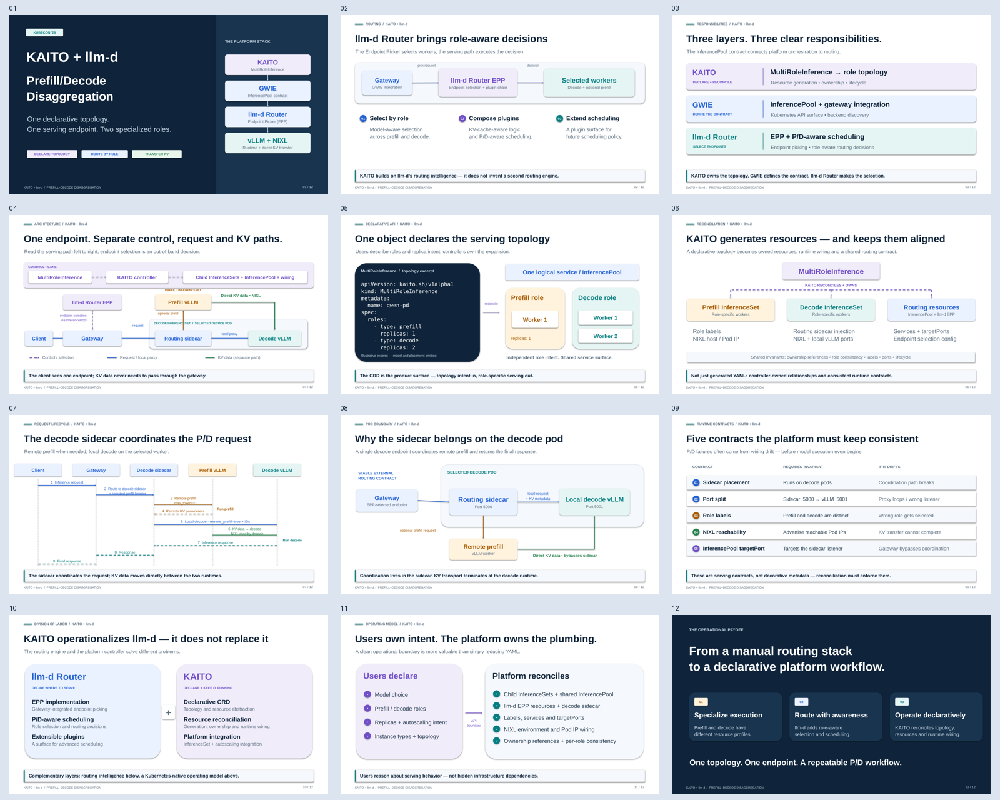

# KAITO + llm-d P/D slide sources



## Current deck: native, editable PowerPoint diagrams

`../kaito-llm-d-pd-slides.pptx` uses native PowerPoint shapes, text boxes and connectors throughout all 12 slides. Diagrams are **not** flattened PNGs or embedded SVGs; select individual objects in PowerPoint to edit their labels, colors and layout. Objects and connectors have descriptive names for the Selection Pane.

The current source of truth is `../generate_kaito_llm_d_pd_slides.py`:

```bash
python3 -m pip install 'python-pptx>=1.0.2'
python3 llm/generate_kaito_llm_d_pd_slides.py
```

The script writes the PPTX next to itself, so it can also be run from another working directory. Regeneration replaces any manual edits made directly in PowerPoint; make persistent layout changes in the script as well.

### Visual conventions

- Purple: control plane, resource ownership and endpoint-selection decisions.
- Blue: gateway, request routing and the decode routing sidecar.
- Amber: prefill role and remote prefill requests.
- Teal: decode role and inference responses.
- Green: direct KV data transfer between runtimes, separate from HTTP coordination.
- Dashed lines: control relationships or response messages, as identified by each diagram.

The request sequence distinguishes **KV data direction** (prefill → decode) from the **read initiator** (decode). Speaker notes include technical context, diagram omissions, the upstream sequence reference and deployment-specific port caveats. The topology YAML is explicitly an excerpt, not an apply-ready manifest.

## Historical assets

The following files are retained as references to earlier diagram iterations; they are **not embedded in the current deck**:

- `d2/*.d2` and `mermaid/*.mmd`
- `slide-04-*.svg` through `slide-11-*.svg`
- `slide-04-*.png` through `slide-11-*.png`
- `kaito-llm-d-pd-slides.drawio`

`export_svg_and_patch_pptx.py` is the legacy SVG export/patch pipeline. Do **not** run it to regenerate the current native-shape deck: it patches the PPTX with the old diagram assets. Use the Python slide generator above instead.
