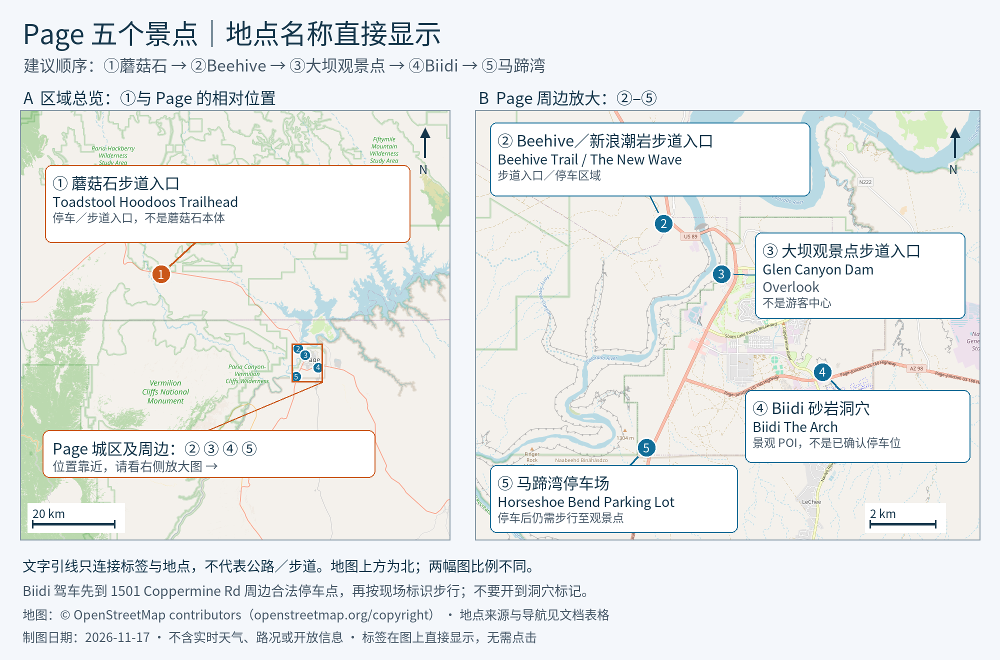

# 2026 年 11 月中旬｜盐湖城出发 Utah / Arizona 8 天行程

这是一份按既定住宿点和路线整理的 8 天自驾行程，起点为 **Salt Lake City（盐湖城）**，11/19 返回盐湖城机场区域并住宿，11/20 从酒店前往 **Avis Car Rental（Avis 租车还车点）** 还车。

本版以已确认的路线和住宿为准，**酒店名称保留英文**，景点与说明尽量采用 **中文 + 中英对照** 的方式，方便出发前直接查看和导航。

---

## 行程总表

> **除 11/14 Capitol Reef → Bryce 段按 NPS 的 UT-12 路线说明更新外，里程与车程沿用所提供的估算，未重新核验地图路线**；不含观景、徒步、停车、接驳、用餐及雨雪路况缓冲。房型与早餐按所提供的信息记录；未注明早餐的酒店不推定含早。

| 日期 | 星期 | 路线 | 参考里程 / 车程 | 住宿 / 房型与早餐 |
|---|---|---|---|---|
| 11.13 | 周五 | **Salt Lake City（盐湖城） → Capitol Reef National Park（圆顶礁国家公园）**；沿途 **Moon Overlook Rd**、**Long Dong Silver Trailhead（长东银步道起点）, Hanksville**、**Moonscape Overlook（月球地貌观景点）, F526+39, Hanksville** | **5 hr 17 min (471 km)** via **US-6 E** | **Broken Spur Inn & Steakhouse**, 955 East UT-24 Building 1, Wayne County, Utah, 84775；**山景房，2 张大床，含早** |
| 11.14 | 周六 | **Broken Spur Inn → Capitol Reef National Park（圆顶礁国家公园） → Bryce Canyon National Park（布莱斯峡谷国家公园）** | **Capitol Reef → Bryce 约 3 小时**（NPS 参考，不含酒店出发及园内游览）；**UT-24 W → UT-12 经 Boulder Mountain → UT-63 S**，里程待导航确认 | **Best Western Plus Bryce Canyon Grand Hotel**, 30 N 100 E, Bryce Canyon City；**2 张大床房，含早** |
| 11.15 | 周日 | **Bryce Canyon City → Zion National Park（锡安国家公园） → Springdale** | **1 hr 51 min (135 km)** via **US-89 S** | **Zion Canyon Lodge**；**标准房，2 张大床** |
| 11.16 | 周一 | **Springdale → Page（佩吉）** | **2 hr 21 min (189 km)** via **US-89 S** | **Best Western View of Lake Powell Hotel**；**2 张大床房，含早** |
| 11.17 | 周二 | **Page（佩吉）**：**Lower Antelope Canyon（下羚羊谷）**、**The New Wave（新浪潮岩）**；另见[五点地图与全天备选](#page-five-stops)（不与导览全天叠加） | 本地活动日 | **Best Western View of Lake Powell Hotel**；**2 张大床房，含早** |
| 11.18 | 周三 | **Page（佩吉） → Forrest Gump Point（阿甘打卡点） → Moab（摩押）** | **4 hr 28 min (430 km)** via **AZ-98 E** | **My Place Hotel-Moab**, 1520 N Main St, Moab, Utah；**2 张大床房** |
| 11.19 | 周四 | **Moab（摩押） → Salt Lake City International Airport（盐湖城国际机场）区域 → 酒店** | **3 hr 41 min (381 km)**（Moab 至机场的提供值，至酒店路段另留余量） | **Spark by Hilton Salt Lake City Airport**；**特大床房，含早** |
| 11.20 | 周五 | **Spark by Hilton Salt Lake City Airport → Avis Car Rental**, 3921 W Terminal Dr, Salt Lake City | **7 min (6.8 km)** | —— |

---

## 每天的安排建议

### 11.13（周五）｜Salt Lake City（盐湖城） → Capitol Reef National Park（圆顶礁国家公园）
- 这是第一天的长距离转场日。
- 按既定路线，沿途可重点关注：
  - **Moon Overlook Rd**（按提供的道路名称保留，导航入口与道路条件需出发前确认）
  - **Long Dong Silver Trailhead（长东银步道起点）, Hanksville**
  - **Moonscape Overlook（月球地貌观景点）, F526+39, Hanksville**
- 当天入住：
  - **Broken Spur Inn & Steakhouse, 955 East UT-24 Building 1, Wayne County, Utah, 84775**
  - **山景房，2 张大床，含早**
- 说明：
  - 如果当天土路条件可以，可以把 **Hanksville（汉克斯维尔）** 一带的景观点尽量安排在这一天完成。
  - 若遇到雨雪或路况一般，建议优先保留主线行程，土路点位保守处理。

### 11.14（周六）｜Broken Spur Inn → Capitol Reef National Park（圆顶礁国家公园） → Bryce Canyon National Park（布莱斯峡谷国家公园）
- 从前一晚的 **Broken Spur Inn & Steakhouse** 出发；这一天以 **Capitol Reef（圆顶礁）** + **Bryce Canyon（布莱斯峡谷）** 为主。
- 当天入住：
  - **Best Western Plus Bryce Canyon Grand Hotel, 30 N 100 E, Bryce Canyon City**
  - **2 张大床房，含早**
- 说明：
  - Capitol Reef 可优先安排 **Visitor Center（游客中心）**、**Fruita Historic District（Fruita 历史聚落）** 一带和 **Scenic Drive（景观公路）**。
  - 路况允许时尽量白天抵达 Bryce；结合 Capitol Reef 游览及途中停靠安排，不为赶观景点在雨雪或结冰时段翻山。

#### Capitol Reef → Bryce：UT-12 经 Boulder Mountain

**铺装公路路线：** Capitol Reef Visitor Center / Fruita → **UT-24 向西** → **Torrey** → 转 **UT-12 向南** → **Boulder Mountain（博尔德山）** → **Boulder, Utah** → **Escalante** → **Henrieville → Cannonville → Tropic** → 转 **UT-63 向南** → **Bryce Canyon City／Bryce Canyon National Park**。

- **导航设置**：以 Capitol Reef Visitor Center 为起点、Bryce Canyon Visitor Center 或酒店为终点，依次添加 **Boulder, Utah**、**Escalante, Utah** 为途经点，并检查导航保持在 **UT-24／UT-12／UT-63** 铺装公路。此处从 Capitol Reef 返回 Torrey 是 **UT-24 W（向西）**，不是向东；酒店先去 Capitol Reef 的路程另计。
- **最高海拔**：NPS 标注 UT-12 在 **Boulder Mountain 的公路最高点约 2,926 m（9,600 ft）**，位于 **Torrey → Boulder 镇** 之间；这是道路海拔，不是山峰海拔，比 Bryce 游客中心约高 500 m。
- **沿途路段**：Torrey → Boulder 翻越高海拔森林路段；Boulder → Escalante 经过 **Hogback 山脊公路**，有弯道和临崖路段，保持低速并仅在安全停车区停靠。
- **车程安排**：NPS 给出 Capitol Reef 与 Bryce 经 UT-12 的车程约 **3 小时**。正常路况下，少量观景停靠可按 **4–5 小时**预留（行程建议，不是实时导航）；不含此前 Capitol Reef 游览。下雪、结冰、清雪或管制时不能保证这个时间。
- **相比最快路线多花多久？** 以 **Capitol Reef Visitor Center → Bryce Canyon Visitor Center** 为同一起终点，2026-11-05 查询 [OSRM 静态驾车路由](https://router.project-osrm.org/route/v1/driving/-111.2615,38.2912;-112.1699,37.6393?overview=false&steps=true&alternatives=true)，未指定途经点时，其最快候选本身就是 **UT-24 W → UT-12 经 Boulder Mountain → UT-63 S**，约 **199 km／3 小时 4 分钟**。因此，**就这次静态路由比较，选择上述 UT-12 景观路线的额外绕行时间基本为 0 分钟**，不能把原先未经核验的“2 小时 30 分钟”当成最快路线并据此声称多花半小时。添加 Boulder、Escalante 镇内途经点的计算约为 **3 小时 5 分钟**，约 1 分钟差异来自具体落点，不是另一条明显更慢的路线。
- **纯驾驶与停靠要分开算**：上面的 **4–5 小时**是含少量观景停靠的行程预算，比约 3 小时纯驾驶多留 **1–2 小时**，不是公路本身多绕这么久。OSRM 是非实时地图模型，**不是 Google Maps 的当天最快路线，也不反映实时交通、积雪或封路**；11/14 出发时应使用相同起终点重新比较导航，并结合 UDOT 管制决定路线。
- **11 月冬季风险**：山顶路段不能套用 Capitol Reef、Bryce 游客中心的天气预报。出发前一天及当天查看 **UT-12 Boulder Mountain 段**的天气、[UDOT 实时路况与摄像头](https://udottraffic.utah.gov/)；优先白天通过，遇积雪、结冰或封路时等待或重新评估路线，不把防滑链视为可以通过封闭道路的许可。
- **避免导航土路捷径**：NPS 特别提醒，不要走从 Lower Bowns Campground / Reservoir 一带通往公园的 **South Draw Road**；这是一条未维护、需高底盘四驱的道路，不适合普通乘用车、房车或缺乏经验的驾驶者。不要为绕开 UT-12 管制而自行走林道或土路。
- **官方参考**：[NPS Capitol Reef — Directions（含 UT-12 路线、约 3 小时车程、2,926 m 海拔及冬季警告）](https://www.nps.gov/care/planyourvisit/directions.htm)。本段为路线说明，**不代表已确认 11/14 道路开放或无冰雪**。

#### Bryce 抵达后徒步备选

- Bryce 徒步可优先考虑：
  - **Queen’s/Navajo Combination Loop（皇后花园 + 纳瓦霍组合环线）**：约 **4.6 km**，约 **2–3 小时**，是最经典、最适合第一次去 Bryce 的线路。
  - 体力保守版可拆成两段：
    - **Navajo Loop（纳瓦霍环线）**：约 **2.2 km**，约 **1–2 小时**。
    - **Queen’s Garden（皇后花园步道，非环线）**：约 **2.9 km**，约 **1–2 小时**。
  - 如果只是补一个轻松步行观景点，可走 **Sunset Point → Sunrise Point（落日点到日出点 Rim Trail）**：约 **1.6 km**，约 **1 小时**，基本最省力。

### 11.15（周日）｜Bryce Canyon City → Zion National Park（锡安国家公园） → Springdale
- 这一天从 **Bryce Canyon（布莱斯峡谷）** 转去 **Zion（锡安）**，再住到 **Springdale（斯普林代尔）**。
- 当天入住：
  - **Zion Canyon Lodge**
  - **标准房，2 张大床**（早餐未注明）
- 说明：
  - Bryce 早上可继续补观景点。
  - 下午到 Zion 后，建议以轻量活动为主，为后续 Zion 徒步留体力。

### 11.16（周一）｜Springdale → Page（佩吉）
- 这一天是从 **Zion / Springdale（锡安 / 斯普林代尔）** 转场去 **Page（佩吉）**。
- 当天入住：
  - **Best Western View of Lake Powell Hotel**
  - **2 张大床房，含早**
- 说明：
  - 如果当天早上还想在 Zion 安排主徒步，可优先考虑 **Angels Landing（天使降临峰）**（有 permit 时）或 **Scout Lookout（侦察台）**（无 permit 时）。
  - 下午到达 Page 后，可视时间安排 **Horseshoe Bend（马蹄湾）**。
- Zion 徒步建议：
  - **Angels Landing（天使降临峰）**：约 **5.4 mi / 8.7 km 往返**，累计爬升约 **1488 ft / 454 m**，多数人约 **4 小时**；**需要 permit**。
  - **Scout Lookout（侦察台）**：从 **The Grotto（Shuttle Stop #6）** 出发，约 **2.25 mi / 3.62 km 单程**，往返通常按 **7.2 km 左右** 估算，约 **3–4 小时**；不需要 Angels Landing permit，也是最自然的替代线。
  - 路线特点：前段会经过 **Refrigerator Canyon（冰箱峡谷）**，后段是 **Walter’s Wiggles（21 个之字形回头弯）**，全程爬升明显，11 月早晚温差会比较大。

### 11.17（周二）｜Page（佩吉）
- 这一天为 **Page（佩吉）本地活动日**。
- 当天入住：
  - **Best Western View of Lake Powell Hotel**
  - **2 张大床房，含早**
- 建议安排：
  - **Lower Antelope Canyon（下羚羊谷）**（提前预约导览团，按预约时间签到）
  - **The New Wave（新浪潮岩）**（与导览时间搭配，留足白天观景时间）
  - 如有余裕，可加 **Glen Canyon Dam Overlook（格伦峡谷大坝观景点）**
  - 如前一天没去成，可补 **Horseshoe Bend（马蹄湾）**
- **当天主计划为下羚羊谷；上羚羊谷仅作备选参考，不默认两处都去。**
- 新增：[Page 五点地图与一日备选计划](#page-five-stops)。这是不含下羚羊谷导览的全天版本；若保留预约，按预约及天气删减，不叠加全部景点，也不改变住宿。
- 羚羊谷步行信息（以 tour operator 公布信息为准）：
  - **Upper Antelope Canyon（上羚羊谷）**：常见 tour 标注约 **1.6 km / 1 mile 步行**，总时长约 **1 小时 40 分**，以平缓步行为主，通常更容易出片。
  - **Lower Antelope Canyon（下羚羊谷）**：常见 tour 标注约 **1.8 km / 1.1 miles 往返步行**，总时长约 **1 小时 30 分**，需要更多上下台阶/梯子，体力要求略高。
  - 这里不是常规意义上的自助徒步，基本都按 **guided tour（导览团）** 走，实际集合时间、车接驳、等候和峡谷内停留时长会因运营商而变化。

<a id="page-five-stops"></a>

#### Page 五点地图与一日备选计划

> **这是一套新增的整日备选，不是把五个点全部叠加在下羚羊谷导览之上。** 仍住 **Best Western View of Lake Powell Hotel**，不改变 11/18 经 Forrest Gump Point 去 Moab 的安排。下羚羊谷若已预约，优先保留预约与签到缓冲；尚未确认预约时刻，不擅自取消或假定某时段可自由活动。若 11/16 已去过马蹄湾，这次可以跳过，不必重复。
>
> **天气优先：** 下面时刻表仅适用于天气、路况和现场开放情况允许的白天。按本文件 **2026-11-17 15:12:59–15:13:02 UTC（当地 11/17 08:13 MST）** 获取的本轮预报，**11/17 Page 镇本轮 08:00–18:00 最高 15°C、降水概率 70%，11:00 前有阵雨可能，11:00–17:00 较可能有阵雨及雷暴，阵风可达 63 km/h**；这是 Page 代表点，不是五个景点逐点预报，也不是实时预警。上午不保证安全，不能为了按表走完而进入冲沟、湿滑岩面或暴露崖边。Page 的 NWS 源更新时间为 **11/17 10:12:49 UTC**，早于获取约 5 小时，并非查询时刚发布。出发前另查各点／上游天气、预警与 [UDOT](https://udottraffic.utah.gov/)／[AZ511](https://az511.gov/map)；本次更新不代表已核实道路、步道或景区开放状态。

##### 地图：五个点与导航

地图编号就是建议游览顺序：**① Toadstool Hoodoos → ② Beehive Trail／The New Wave → ③ Glen Canyon Dam Overlook → ④ Biidi the Arch → ⑤ Horseshoe Bend**。先去最远的蘑菇石，再沿 US-89 返回 Page 一带，减少往返折返。

**先看文字标注地图：五个地点的名称直接显示，不用点击标记。** 左图显示蘑菇石与 Page 的相对位置，右图放大 Page 周边四个点，避免地名挤在一起。编号仍与下方表格、建议游览顺序一致；可点击图片放大。

[](assets/page-five-stops-labeled.png)

**地图口径：** 底图 © [OpenStreetMap contributors](https://www.openstreetmap.org/copyright)，制图日期 2026-11-17；沿用已核对的五点坐标。文字引线只连接标签与地点，**不是公路或徒步路线**。①②③标步道入口／停车区域，④标景观 POI、不是已确认停车位，⑤标马蹄湾停车场；不要把 Biidi 洞穴坐标当作驾车终点。地图不含实时天气、路况或开放信息，导航仍用下方链接并遵守现场标识。

**交互地图仍保留：** 以下 GitHub 原生 `geojson` 地图可缩放，点击标记查看地点属性；固定地名以先前图片为准，不能假定所有客户端都把 GeoJSON 的 `name` 属性直接画成常显标签。若客户端只显示代码，请打开 GitHub 网页或使用下方 Google Maps 链接。GeoJSON 坐标顺序为 **经度、纬度**，表内则为 **纬度、经度**。

```geojson
{
  "type": "FeatureCollection",
  "features": [
    {
      "type": "Feature",
      "properties": {
        "name": "1. Toadstool Hoodoos Trailhead",
        "说明": "步道入口／停车区域，不是蘑菇石本体",
        "Google Maps": "https://maps.app.goo.gl/mQvUvj67TpCHjqUE8",
        "坐标来源": "https://www.naztrails.org/toadstools-trail",
        "marker-color": "#1769aa",
        "marker-size": "medium",
        "marker-symbol": "1"
      },
      "geometry": {
        "type": "Point",
        "coordinates": [
          -111.873205,
          37.10128333
        ]
      }
    },
    {
      "type": "Feature",
      "properties": {
        "name": "2. Beehive Trail / The New Wave",
        "说明": "Beehives 步道入口／停车区域，不是营地预订点",
        "Google Maps": "https://maps.app.goo.gl/U7KhSMK63BpGaBbH6",
        "坐标来源": "https://www.naztrails.org/beehives-trail",
        "marker-color": "#1769aa",
        "marker-size": "medium",
        "marker-symbol": "2"
      },
      "geometry": {
        "type": "Point",
        "coordinates": [
          -111.49687667,
          36.93792667
        ]
      }
    },
    {
      "type": "Feature",
      "properties": {
        "name": "3. Glen Canyon Dam Overlook",
        "说明": "观景步道入口／停车区域，不是游客中心",
        "Google Maps": "https://maps.app.goo.gl/Pv75NQuJXGxzjH5F7",
        "坐标来源": "https://www.naztrails.org/glen-canyon-dam-overlook-trail",
        "marker-color": "#1769aa",
        "marker-size": "medium",
        "marker-symbol": "3"
      },
      "geometry": {
        "type": "Point",
        "coordinates": [
          -111.47706,
          36.92404667
        ]
      }
    },
    {
      "type": "Feature",
      "properties": {
        "name": "4. Biidi The Arch",
        "说明": "景观 POI，不是已确认停车位；驾车先到1501CoppermineRd周边合法停车点",
        "Google Maps": "https://www.google.com/maps/search/?api=1&query=Biidi+The+Arch+Page",
        "坐标来源": "https://www.google.com/maps/place/Biidi+The+Arch/@36.8971304,-111.442353,17z/data=!3m1!4b1!4m6!3m5!1s0x873413004d5352c1:0xb5c2bd7f1adf1864!8m2!3d36.8971304!4d-111.442353!16s%2Fg%2F11yfh0pz1j?hl=en",
        "marker-color": "#1769aa",
        "marker-size": "medium",
        "marker-symbol": "4"
      },
      "geometry": {
        "type": "Point",
        "coordinates": [
          -111.442353,
          36.8971304
        ]
      }
    },
    {
      "type": "Feature",
      "properties": {
        "name": "5. Horseshoe Bend Parking Lot",
        "说明": "停车场 POI，不是马蹄湾崖沿或科罗拉多河",
        "Google Maps": "https://www.google.com/maps/search/?api=1&query=Horseshoe+Bend+Parking+Lot+Page",
        "坐标来源": "https://grandcanyon.com/poi/horseshoe-bend-overlook-parking-lot/",
        "marker-color": "#1769aa",
        "marker-size": "medium",
        "marker-symbol": "5"
      },
      "geometry": {
        "type": "Point",
        "coordinates": [
          -111.5028016,
          36.876343
        ]
      }
    }
  ]
}
```

| 顺序 | 地点／Google Maps | 地图标记含义 | 坐标（纬度，经度）／来源 |
|---|---|---|---|
| **1** | [Toadstool Hoodoos Trailhead](https://maps.app.goo.gl/mQvUvj67TpCHjqUE8) | 步道入口／停车区域，不是蘑菇石本体 | `37.10128333, -111.873205` · [来源](https://www.naztrails.org/toadstools-trail) |
| **2** | [Beehive Trail / The New Wave](https://maps.app.goo.gl/U7KhSMK63BpGaBbH6) | Beehives 步道入口／停车区域，不是营地预订点 | `36.93792667, -111.49687667` · [来源](https://www.naztrails.org/beehives-trail) |
| **3** | [Glen Canyon Dam Overlook](https://maps.app.goo.gl/Pv75NQuJXGxzjH5F7) | 观景步道入口／停车区域，不是游客中心 | `36.92404667, -111.47706` · [来源](https://www.naztrails.org/glen-canyon-dam-overlook-trail) |
| **4** | [Biidi The Arch](https://www.google.com/maps/search/?api=1&query=Biidi+The+Arch+Page) | 景观 POI，不是已确认停车位；驾车先到1501CoppermineRd周边合法停车点 | `36.8971304, -111.442353` · [来源](https://www.google.com/maps/place/Biidi+The+Arch/@36.8971304,-111.442353,17z/data=!3m1!4b1!4m6!3m5!1s0x873413004d5352c1:0xb5c2bd7f1adf1864!8m2!3d36.8971304!4d-111.442353!16s%2Fg%2F11yfh0pz1j?hl=en) |
| **5** | [Horseshoe Bend Parking Lot](https://www.google.com/maps/search/?api=1&query=Horseshoe+Bend+Parking+Lot+Page) | 停车场 POI，不是马蹄湾崖沿或科罗拉多河 | `36.876343, -111.5028016` · [来源](https://grandcanyon.com/poi/horseshoe-bend-overlook-parking-lot/) |


**分段驾驶导航：** [酒店 → ① 蘑菇石入口](https://www.google.com/maps/dir/?api=1&origin=Best+Western+View+of+Lake+Powell+Hotel%2C+Page%2C+AZ&destination=37.10128333%2C-111.873205&travelmode=driving) · [① → ② → ③ → ④ 周边街道地址 → ⑤ 停车场](https://www.google.com/maps/dir/?api=1&origin=37.10128333%2C-111.873205&destination=36.876343%2C-111.5028016&waypoints=36.93792667%2C-111.49687667%7C36.92404667%2C-111.47706%7C1501+Coppermine+Rd%2C+Page%2C+AZ+86040&travelmode=driving) · [⑤ → 酒店](https://www.google.com/maps/dir/?api=1&origin=36.876343%2C-111.5028016&destination=Best+Western+View+of+Lake+Powell+Hotel%2C+Page%2C+AZ&travelmode=driving)。

- 中段路线含三个途经点，Biidi 使用 **1501 Coppermine Rd** 的街道地址，**不把洞穴坐标当作驾车终点**；停车位置和可进入通道仍需现场确认。
- 如手机／客户端忽略途经点，按表格逐点导航；地图与链接只辅助定位，不保证当天道路可通行、停车位可用或景点开放。

##### 建议时刻表：不含下羚羊谷导览的全天版本

时间均为 **当地 MST（UTC−7）**；本行程日期 Utah 与 Page 没有时差。**车程是规划估算，不是实时导航计算**，不反映堵车、雨雪、封路、排队；走合法道路，按现场停车与通行标识调整。

| 当地时间 | 安排 | 建议预留／说明 |
|---|---|---|
| **08:00–08:45** | 从 Page 酒店出发 → **① Toadstool Hoodoos Trailhead** | 约 40–45 分钟车程，先去最远点 |
| **08:45–10:15** | **蘑菇石徒步、拍照** | 约 1–1.5 小时；往返约 2.5–3 km，探索范围影响长度 |
| **10:15–11:00** | 沿 US-89 往 Page 返回 → **② Beehive Trail／The New Wave** | 约 35–45 分钟车程 |
| **11:00–12:15** | **Beehive 主环线、波纹岩石拍照** | 约 1–1.25 小时；主环线约 2–3 km，不加远处洞穴支线 |
| **12:15–13:00** | 开车 → **③ Glen Canyon Dam Overlook**，观景 | 车程约 10–15 分钟；停留约 20–30 分钟 |
| **13:00–14:00** | 回 Page 午餐、休息 | 留出停车、用餐及天气调整缓冲 |
| **14:00–14:40** | **④ Biidi the Arch** | 包括附近转场、短途步行与拍照，约 30–40 分钟 |
| **14:40–16:15** | 开车 → **⑤ Horseshoe Bend Parking Lot**，步行至马蹄湾观景点再返回 | 车程约 10–15 分钟；游览预留 1–1.25 小时，往返约 2.4 km |
| **16:15 后** | 返回 Page 酒店 | 不必为了日落一直等在崖边，不把徒步拖到天黑 |

**整体按约 8–9 小时、步行约 7–9 km 预算。** 上表为行程分配建议，不是已确认预约或实时路由；沙地、岩面、拍照和绕行都会增加耗时。早餐、饮水和防风层提前准备，手机保存离线地图；不要把“短线”理解成无需看天气。

##### 五个地点的取舍与注意事项

1. **Toadstool Hoodoos（蘑菇石）**：优先上午、留足拍照时间；不攀爬脆弱岩柱，沿既有路线走。路线含冲沟／排水地形，有雷暴、上游降雨、积水或泥泞风险时取消；“本地还没下雨”不是安全依据。导航到 **Trailhead**，不是让车辆开到蘑菇石本体；不是较远的 Wahweap Hoodoos。
2. **Beehive Trail／The New Wave（新浪潮岩）**：这里指 **Page 附近、Glen Canyon Dam 西侧的步道**，不是 Acadia 的同名铁梯步道，也不是需要抽签的 The Wave。主环线拍照即可，不加长支线、不为照片攀爬湿滑岩面；遇雷电、强风或湿岩面就跳过。入口支路及停车条件以现场为准，不自行驶入沙地或未维护土路。
3. **Glen Canyon Dam Overlook（格伦峡谷大坝观景点）**：这是看大坝和下游峡谷的观景点，**不是 Carl Hayden Visitor Center，也不是大坝内部参观**。短停 20–30 分钟即可；岩石台阶雨后易滑，靠近停车场不等于雷暴时安全。
4. **Biidi the Arch（砂岩洞穴）**：位于 **1501 Coppermine Road 的 Big Lake Trading Post／Shell 加油站后方**，是顺路小景点，不是长线拱门徒步。按现场允许的位置停车、确认进入通道和标识，不阻挡加油或商家出入口；**不能把砂岩洞穴／岩檐当作雷暴避难处**。
5. **Horseshoe Bend（马蹄湾）**：导航到 **停车场**，不是河边或崖沿。停车场至观景点往返约 **2.4 km**，不是下车即到。下午从容游览，不必执着日落；远离无护栏崖边，强风、雷暴时取消。2026-11-17 查阅的 [NPS 页面](https://www.nps.gov/glca/planyourvisit/horseshoe-bend.htm)列普通轿车／房车停车费 **$10**，国家公园年票不抵停车费，以现场最新收费为准。

##### 若保留下羚羊谷预约，或 11/17 天气不佳

- **有下羚羊谷预约**：以实际集合／签到时间为锚点，按运营商要求另留签到、接驳、等候及往返车程；不要同时承诺上面完整五点时刻表。天气允许时，可在剩余白天优先挑 **Glen Canyon Dam Overlook＋Biidi＋Horseshoe Bend**，次序按预约位置调整；**Toadstool、Beehive 是优先删减项**。The New Wave 与 Beehive 是同一活动，不重复安排。
- **预报或现场出现雷暴、强风**：不要把三个短停点当成全天候替代方案；马蹄湾和大坝观景点同样暴露。取消冲沟徒步、裸露岩面和崖边活动，改在镇内合适建筑中休息、用餐或等天气改善；雷暴期间不在洞穴／岩檐下避雷。羚羊谷是否运营以运营商与管理方通知为准，关闭时不自行进入。
- **缩减而不是挤到次日**：11/18 原计划仍需经阿甘打卡点去 Moab，不默认把今天未完成的五点都补到转场日；优先保证白天驾驶和既定住宿。

**地图与步道资料（2026-11-17 核对）：** [Northern Arizona Trails：Toadstools](https://www.naztrails.org/toadstools-trail)、[Beehives](https://www.naztrails.org/beehives-trail)、[Glen Canyon Dam Overlook](https://www.naztrails.org/glen-canyon-dam-overlook-trail) 提供步道入口坐标与停车说明；前三点由源文度分坐标换算为十进制度，末尾小数不代表厘米级精度。Biidi 采用 Google Maps 同名 POI 坐标及地址、不是已核实停车位；马蹄湾采用 [停车场位置资料](https://grandcanyon.com/poi/horseshoe-bend-overlook-parking-lot/)，明确区别于崖沿。步道安全与收费参考 [NPS 马蹄湾说明](https://www.nps.gov/glca/planyourvisit/horseshoe-bend.htm) 和 [NPS Glen Canyon 日间步道](https://www.nps.gov/glca/planyourvisit/day-hikes.htm)。这些资料用于定位与规划，不构成当前开放／准入保证。

### 11.18（周三）｜Page（佩吉） → Forrest Gump Point（阿甘打卡点） → Moab（摩押）
- 这一天从 Page 继续北上，经 **Forrest Gump Point（阿甘打卡点）** 前往 **Moab（摩押）**。
- 当天入住：
  - **My Place Hotel-Moab, 1520 N Main St, Moab, Utah**
  - **2 张大床房**（早餐未注明）
- 说明：
  - 如果时间允许，也可以结合当日体力和天气，考虑 **Monument Valley（纪念碑谷）** 一带的停留时间。
  - 这一天整体仍属于景观转场日，建议不要额外塞过多徒步。

### 11.19（周四）｜Moab（摩押） → Salt Lake City International Airport（盐湖城国际机场）区域
- 这一天从 Moab 返回盐湖城机场区域，**不是 Moab 整日本地活动日**。
- 参考车程：**3 hr 41 min (381 km)**（所提供的 Moab 至机场估算；至酒店路段另留余量）。
- 当天入住：
  - **Spark by Hilton Salt Lake City Airport**
  - **特大床房，含早**
- 如需在 Moab 观景，只安排不影响返程的短时活动；留足长途驾驶、用餐及雨雪路况缓冲。
- **当晚先住机场附近酒店，次日再还车**，不是当天还车或默认当天搭机。

### 11.20（周五）｜酒店 → Avis Car Rental（Avis 租车还车点）
- 从 **Spark by Hilton Salt Lake City Airport** 出发，前往：
  - **Avis Car Rental, 3921 W Terminal Dr, Salt Lake City**
- 参考车程：**7 min (6.8 km)**。
- 这是酒店至还车点的驾驶估算，不含加油、还车检查、前往航站楼、值机和安检；若当天搭机，请按实际航班时间另留缓冲。

---

## 重点地点清单（中文 + 英文）

### Hanksville / Capitol Reef 一段
- **Long Dong Silver Trailhead（长东银步道起点）**, Hanksville
- **Moonscape Overlook（月球地貌观景点）**, F526+39, Hanksville
- **Capitol Reef National Park（圆顶礁国家公园）**
- **Moon Overlook Rd**
- **Broken Spur Inn & Steakhouse**, 955 East UT-24 Building 1, Wayne County, Utah, 84775

### Bryce / Zion 一段
- **Bryce Canyon National Park（布莱斯峡谷国家公园）**
- **Springdale（斯普林代尔）**
- **Best Western Plus Bryce Canyon Grand Hotel**, Bryce Canyon City
- **Zion Canyon Lodge**, Springdale
- **Zion National Park（锡安国家公园）**
- **Angels Landing（天使降临峰） / Scout Lookout（侦察台）**（按 permit 情况决定）

### Page 一段
- **Page（佩吉）**
- **Lower Antelope Canyon（下羚羊谷）**
- **The New Wave（新浪潮岩）／Beehive Trail**
- **Toadstool Hoodoos Trailhead（蘑菇石步道入口）**
- **Biidi the Arch（砂岩洞穴）**
- [五点地图与驾驶导航](#page-five-stops)
- **Best Western View of Lake Powell Hotel**
- **Horseshoe Bend（马蹄湾）**
- **Glen Canyon Dam Overlook（格伦峡谷大坝观景点）**

### 北返一段
- **Forrest Gump Point（阿甘打卡点）**
- **Moab（摩押）**
- **My Place Hotel-Moab**, 1520 N Main St, Moab, Utah
- **Salt Lake City International Airport（盐湖城国际机场）**
- **Spark by Hilton Salt Lake City Airport**
- **Avis Car Rental**, 3921 W Terminal Dr, Salt Lake City

---

## 重点徒步 / 步行路线补充

> 以下距离和耗时以 **官方 / 景区公开页面的常见标注** 为准，实际会受停车、shuttle、permit、天气、冰雪和现场限流影响。

### Bryce Canyon National Park（布莱斯峡谷国家公园）
- **首选**：**Queen’s/Navajo Combination Loop（皇后花园 + 纳瓦霍组合环线）**
  - 距离：约 **4.6 km**
  - 耗时：约 **2–3 小时**
  - 特点：第一次去 Bryce 最值得走的一条，能同时看到 **Queen’s Garden（皇后花园）**、**Wall Street / Two Bridges（华尔街 / 双桥）** 一带的典型地貌。
- **轻量版**：**Sunset Point → Sunrise Point（落日点到日出点 Rim Trail）**
  - 距离：约 **1.6 km**
  - 耗时：约 **1 小时**
  - 特点：主要沿 rim 看 hoodoos（石林尖塔），省体力，适合天气差或只想轻松走走时。

### Zion National Park（锡安国家公园）
- **有 permit 时首选**：**Angels Landing（天使降临峰）**
  - 距离：约 **8.7 km 往返**
  - 耗时：约 **4 小时**
  - 特点：经典线路，但暴露感强，最后带铁链的 ridge 段需要 permit。
- **无 permit 时首选**：**Scout Lookout（侦察台） / West Rim Trail 前段**
  - 距离：约 **3.62 km 单程**，往返通常按 **7.2 km 左右** 估算
  - 耗时：约 **3–4 小时**
  - 特点：景观已经很强，也是去 Angels Landing 前的大平台；不进最后铁链段也很值。

### Antelope Canyon（羚羊峡谷）

> **11/17 安排 Lower Antelope Canyon（下羚羊谷）**；Upper 仅保留作路线比较，不是当天额外必去项目。

- **Upper Antelope Canyon（上羚羊谷）**
  - 步行：约 **1.6 km / 1 mile**
  - 总时长：约 **1 小时 40 分**
  - 特点：步行相对平缓，拍光影更友好。
- **Lower Antelope Canyon（下羚羊谷）**
  - 步行：约 **1.8 km / 1.1 miles 往返**
  - 总时长：约 **1 小时 30 分**
  - 特点：需要更多台阶和梯子，线路更像“峡谷穿行”。
- 备注：羚羊谷通常按 **导览团** 进入，不是普通 trailhead 自助徒步；当天请把 **签到、接驳、等待** 时间也算进总安排里。

## 主要景点参考海拔（米）

> 以下海拔为 **近似值**，统一使用 **米（m）** 表示；优先按常用游客中心、停车点、观景点或公开坐标附近的海拔整理，主要用于判断温差、低温和路况风险。

- **Long Dong Silver Trailhead（长东银步道起点）**：约 **1366 m**
- **Moonscape Overlook（月球地貌观景点）**：约 **1500 m**
- **Factory Butte（工厂孤峰）**：约 **1807 m**
- **Capitol Reef Visitor Center / Fruita 一带（圆顶礁游客中心 / Fruita 区域）**：约 **1678 m**
- **Bryce Canyon City（布莱斯峡谷城）**：约 **2339 m**
- **Bryce Point / Bryce Rim（布莱斯主要观景缘）**：约 **2485 m**
- **Zion Canyon Visitor Center（锡安峡谷游客中心）**：约 **1203 m**
- **Angels Landing（天使降临峰）**：约 **1760 m**
- **Page（佩吉）**：约 **1325 m**
- **Antelope Canyon（羚羊峡谷）**：约 **1165 m**
- **Horseshoe Bend（马蹄湾）**：约 **1119 m**
- **Glen Canyon Dam Overlook（格伦峡谷大坝观景点）**：约 **1196 m**
- **Forrest Gump Point（阿甘打卡点）**：约 **1562 m**
- **Monument Valley Visitor Center（纪念碑谷游客中心）**：约 **1711 m**
- **Moab（摩押）**：约 **1240 m**

---

## 天气 / 路况查询网站

- 美国国家气象局 **NWS / weather.gov**：<https://www.weather.gov/>
- **Hanksville（汉克斯维尔）天气预报（NWS，摄氏度）**：[查看未来约 7 天天气](https://forecast.weather.gov/MapClick.php?lat=38.3736&lon=-110.714&unit=1)
  - 对应 **Hanksville 镇附近**，坐标 **38.3736, -110.714**；不是 Lake Blanche 附近的山区预报。
  - 可查看最高／最低温、降水概率及逐小时预报。**11/13 出行前 3–5 天再次确认，前一天复查**；远期预测只用于看趋势。
  - 镇上预报不等于 Moonscape、Factory Butte 等镇外景点的实际天气或土路通行情况，还需核对目的地及此前几天的降雨。
- **Utah** 路况：<https://udottraffic.utah.gov/>
- **Zion（锡安）** 周边路况：<https://zionarea.udot.utah.gov/>
- **Arizona** 路况：<https://az511.gov/map>
- **Capitol Reef（圆顶礁）** 当前情况：<https://www.nps.gov/care/planyourvisit/conditions.htm>
- **Bryce（布莱斯）** 当前情况：<https://www.nps.gov/brca/planyourvisit/conditions.htm>
- **Zion（锡安）** 当前情况：<https://www.nps.gov/zion/planyourvisit/conditions.htm>

<a id="hanksville-1121114-天气预测快照"></a>

### Hanksville、Capitol Reef、Bryce、Zion、Page、下羚羊谷、拱门国家公园、Forrest Gump Point、盐湖城：11/13–11/20 天气预测

**范围与口径：** 本次在同一批次重新获取下列**全部九个独立代表点**：Hanksville、Capitol Reef／Fruita、Bryce、Zion、Page、Lower Antelope Canyon（下羚羊谷）、Arches National Park（拱门国家公园）、Forrest Gump Point（阿甘打卡点）及 Salt Lake City 国际机场区域。保留当地 **2026-11-13 至 11-20（8 个自然日）**模型窗口，路线与住宿不变。下羚羊谷不是 Page 镇或上羚羊谷的别名；盐湖城机场代表点仅对应 11/19 住宿、11/20 还车，不代表整个城市、山地或北返沿线。

- **全部天气获取时间：2026-11-17 15:12:59–15:13:02 UTC（当地 11/17 08:12:59–08:13:02 MST）**。Utah `America/Denver`、Page／下羚羊谷 `America/Phoenix` 在这些日期均为 **UTC−7**；静态文档不会自动更新。
- **Open-Meteo** 温度为当地自然日 00:00–24:00 最高／最低（°C）；概率为日内最大小时降水概率（%，小时阈值 >0.1 mm），不是全天累计概率。日总降水为**液态水当量 mm**，不是降雪深度或地面积雪。**11/13–11/16 已过去，仅为 API 返回的历史模型上下文（非实测）；当地现在是 11/17 早晨，11/17 是包含已过小时的整日模型值，不是剩余时段预报；11/18–11/20 为未来自然日。** 源值小数不表示精度有保证。
- **NWS** 温度为白天最高／当晚最低（°C）。本轮九点首段均为 **11/17 08:00–18:00 MST 部分白天**，获取时该段最初约 13 分钟已过；之后白天 06:00–18:00、当晚 18:00–次日 06:00。**11/13–11/16 及 11/17 白天 06:00–08:00 未提供，不回填旧预报，也不把首段扩为完整白天。** 截至 11/20 当晚（至 11/21 06:00）；当晚最低不等于同日清晨最低。API 超出窗口的其余时段不纳入。
- **NWS 概率取 API 数值字段 `probabilityOfPrecipitation`**，分白天／当晚；详细文字可能取整（如下羚羊谷 11/17 白天数值 **71%**、文字 70%）。这是降水概率，**不是雷暴或山洪概率**，也不等同于 Open-Meteo 日内最高概率。中文天气核对 `shortForecast` 与 `detailedForecast`，保留关键时段、雨雪转换、雷暴、阵风、新雪及风寒提示。
- **风单位均为 km/h**：NWS 风速列为时段风速范围，**不是阵风**；文字中的阵风来自详细预报。Open-Meteo 为自然日最大 10 m 风速／阵风。**异常†** 表示源阵风小于最大风速，暂不采用该阵风值，原值另列，不改成 0。模型天气代码与温度、概率、雨量不一致时保留并标明，不擅自解释原因。
- “未提供”不同于 0；**0% 或 0.0 mm 不保证无雨雪，更不保证无旧雪、结冰或山洪风险**。不同网格、海拔和统计时段不能直接相减判断变暖／变冷；远期最低不能作为保暖下限。NWS 新雪为降雪深度 cm，新增降雨为液态降雨 cm，不与模型水当量 mm 混用。模型天气代码不是官方预警。
- **NWS 源更新时间（不是获取时间）**：Hanksville／Capitol Reef／Bryce／Zion／盐湖城的 SLC 网格为 **2026-11-17 06:31:26 UTC（当地 11/16 23:31:26 MST）**，早于本次获取约 **8 小时 42 分钟**；Page／下羚羊谷的 FGZ 网格为 **2026-11-17 10:12:49 UTC（当地 11/17 03:12:49 MST）**，早约 **5 小时**；拱门／Forrest Gump Point 的 GJT 网格为 **2026-11-17 14:42:23 UTC（当地 11/17 07:42:23 MST）**，早约 **31 分钟**。源更新早于查询，尤其 SLC 网格并非刚发布；请求带 `Cache-Control: no-cache`，但不保证数据已更新到当前分钟。Open-Meteo 未返回模型起报时刻，不能保证所有变量同轮次。说明：[Open-Meteo 变量与 WMO 代码](https://open-meteo.com/en/docs)。两源分表，不跨源拼接。本次仅刷新天气 API，**未核实实时预警、道路、公园或导览运营状态**。

#### Hanksville 镇附近：11/13–11/20

- **请求坐标（纬度，经度）**：`38.3736, -110.714`；时区 `America/Denver`。
- **Open-Meteo 返回网格中心**：`38.37721, -110.69799`；海拔约 **1,311 m**。
- **NWS 网格**：`SLC/128,63`；海拔约 **1,331 m**（API 网格高度，不等于景点各处实际海拔）。
- **查询时间**：NWS 2026-11-17 15:13:00 UTC；Open-Meteo 2026-11-17 15:13:00 UTC。**NWS 源更新时间**：2026-11-17 06:31:26 UTC。

**Open-Meteo 8 天模型：11/13–11/16 为历史模型上下文（非实测）；11/17 包含已过小时，不是剩余时段预报；11/18–11/20 为未来自然日。**

| 日期（2026，当地） | 模型天气（WMO） | 日最高／日最低（°C） | 降水概率（日内最高，%） | 日总降水（水当量，mm） | 日最大风速／阵风（km/h） |
|---|---|---:|---:|---:|---:|
| 11-13 | 阴（3） | 14.0／0.7 | 14 | 0.0 | 8.1／16.6 |
| 11-14 | 阴（3） | 14.5／5.9 | 38 | 0.0 | 13.7／32.8 |
| 11-15 | 阴（3） | 13.4／1.1 | 0 | 0.0 | 10.4／15.1 |
| 11-16 | 局部多云（2） | 14.4／1.2 | 1 | 0.0 | 6.2／16.6 |
| 11-17 | 小雨（61） | 13.9／1.5 | 69 | 1.4 | 38.6／60.5 |
| 11-18 | 阴（3） | 11.1／0.2 | 0 | 0.0 | 10.9／18.7 |
| 11-19 | 阴（3） | 12.6／0.3 | 22 | 0.0 | 31.1／异常† |
| 11-20 | 阴（3） | 10.8／3.8 | 28 | 0.0 | 28.2／53.6 |

**NWS 官方预报：首段 11/17 08:00–18:00 为部分白天；其后白天 06:00–18:00、当晚 18:00–次日 06:00。** 获取时首段最初约 13 分钟已过。11/13–11/16 及 11/17 白天 06:00–08:00 本轮未提供，不回填旧值；末段结束于 11/21 06:00，即 11/20 当晚包含 11/21 清晨。概率用 API 数值字段；风速列不是阵风。

| 日期（2026，当地） | 白天／当晚天气 | 白天最高／当晚最低（°C） | 降水概率：白天／当晚（%） | 风速范围：白天／当晚（km/h） |
|---|---|---:|---:|---:|
| 11-17 | 11:00 前有雨可能，11:00–17:00 阵雨及雷暴；局部晴，午后气温降至约 12°C；阵风可达 61 km/h／大部晴朗，夜间气温回升至约 -1°C；阵风可达 61 km/h | 14／-2 | 84／5 | 22–43／4–41 |
| 11-18 | 晴，午后气温降至约 9°C／大部多云 | 11／-2 | 0／0 | 0–7／0–6 |
| 11-19 | 17:00 后较可能有雨，大部多云／次日 02:00 前较可能有雨，02:00–05:00 较可能有雨雪，05:00 后有小概率雨雪；大部多云 | 11／1 | 59／59 | 4／2–24 |
| 11-20 | 11:00 前有小概率雨雪，大部晴／23:00–次日 05:00 有小概率雪，局部多云；可能新增不足 1 cm 雪 | 11／-4 | 19／15 | 9–31／0–9 |

来源：[NWS 页面（摄氏度）](https://forecast.weather.gov/MapClick.php?lat=38.3736&lon=-110.714&unit=1) · [NWS 点位解析](https://api.weather.gov/points/38.3736,-110.714) · [NWS API（摄氏度）](https://api.weather.gov/gridpoints/SLC/128,63/forecast?units=si) · [Open-Meteo API（11/13–11/20）](https://api.open-meteo.com/v1/forecast?latitude=38.3736&longitude=-110.714&daily=temperature_2m_max%2Ctemperature_2m_min%2Cprecipitation_probability_max%2Cprecipitation_sum%2Cweather_code%2Cwind_speed_10m_max%2Cwind_gusts_10m_max&timezone=America%2FDenver&start_date=2026-11-13&end_date=2026-11-20&temperature_unit=celsius&precipitation_unit=mm&wind_speed_unit=kmh)。

#### Capitol Reef Visitor Center／Fruita 附近：11/13–11/20

- **请求坐标（纬度，经度）**：`38.2916, -111.2615`；时区 `America/Denver`。
- **Open-Meteo 返回网格中心**：`38.283554, -111.27136`；海拔约 **1,674 m**。
- **NWS 网格**：`SLC/109,62`；海拔约 **1,874 m**（API 网格高度，不等于景点各处实际海拔）。
- **查询时间**：NWS 2026-11-17 15:12:59 UTC；Open-Meteo 2026-11-17 15:13:00 UTC。**NWS 源更新时间**：2026-11-17 06:31:26 UTC。

**Open-Meteo 8 天模型：11/13–11/16 为历史模型上下文（非实测）；11/17 包含已过小时，不是剩余时段预报；11/18–11/20 为未来自然日。**

| 日期（2026，当地） | 模型天气（WMO） | 日最高／日最低（°C） | 降水概率（日内最高，%） | 日总降水（水当量，mm） | 日最大风速／阵风（km/h） |
|---|---|---:|---:|---:|---:|
| 11-13 | 阴（3） | 11.6／2.8 | 27 | 0.0 | 16.2／26.6 |
| 11-14 | 小毛毛雨（51） | 12.1／4.4 | 48 | 0.4 | 31.0／49.3 |
| 11-15 | 阴（3） | 11.4／1.5 | 0 | 0.0 | 27.0／36.0 |
| 11-16 | 阴（3） | 12.2／1.4 | 1 | 0.0 | 20.4／27.7 |
| 11-17 | 中雨（63） | 11.7／1.0 | 80 | 8.3 | 47.9／87.1 |
| 11-18 | 阴（3） | 9.2／0.7 | 0 | 0.0 | 19.1／33.8 |
| 11-19 | 小毛毛雨（51） | 10.3／0.6 | 55 | 0.3 | 24.8／40.3 |
| 11-20 | 阴（3） | 7.5／0.8 | 60 | 0.0 | 27.2／41.0 |

**NWS 官方预报：首段 11/17 08:00–18:00 为部分白天；其后白天 06:00–18:00、当晚 18:00–次日 06:00。** 获取时首段最初约 13 分钟已过。11/13–11/16 及 11/17 白天 06:00–08:00 本轮未提供，不回填旧值；末段结束于 11/21 06:00，即 11/20 当晚包含 11/21 清晨。概率用 API 数值字段；风速列不是阵风。

| 日期（2026，当地） | 白天／当晚天气 | 白天最高／当晚最低（°C） | 降水概率：白天／当晚（%） | 风速范围：白天／当晚（km/h） |
|---|---|---:|---:|---:|
| 11-17 | 11:00 前有雨，11:00–14:00 阵雨及雷暴，14:00–17:00 有雨雪可能；局部晴，午后气温降至约 7°C；阵风可达 54 km/h；新增降雨可能不足 0.5 cm／大部晴朗，夜间气温回升至约 -2°C；阵风可达 54 km/h | 9／-3 | 88／4 | 24–33／13–33 |
| 11-18 | 晴，午后气温降至约 4°C／大部多云 | 6／-2 | 0／0 | 6–15／9 |
| 11-19 | 17:00 后较可能有雨雪，大部多云／雨雪，大部多云；新增降雨可能不足 0.5 cm | 7／0 | 71／82 | 4–9／6–17 |
| 11-20 | 11:00 前有雪可能，大部晴／大部晴朗 | 6／-4 | 30／6 | 9–24／9–17 |

来源：[NWS 页面（摄氏度）](https://forecast.weather.gov/MapClick.php?lat=38.2916&lon=-111.2615&unit=1) · [NWS 点位解析](https://api.weather.gov/points/38.2916,-111.2615) · [NWS API（摄氏度）](https://api.weather.gov/gridpoints/SLC/109,62/forecast?units=si) · [Open-Meteo API（11/13–11/20）](https://api.open-meteo.com/v1/forecast?latitude=38.2916&longitude=-111.2615&daily=temperature_2m_max%2Ctemperature_2m_min%2Cprecipitation_probability_max%2Cprecipitation_sum%2Cweather_code%2Cwind_speed_10m_max%2Cwind_gusts_10m_max&timezone=America%2FDenver&start_date=2026-11-13&end_date=2026-11-20&temperature_unit=celsius&precipitation_unit=mm&wind_speed_unit=kmh)。

区域说明：[NPS Capitol Reef 天气页面](https://www.nps.gov/care/planyourvisit/weather.htm) 将 Fruita、北部 Cathedral Valley、南部 Halls Creek 分开预报；本表只选 Fruita 代表点，不代表 Torrey 酒店或 UT-12 山顶。[NWS Fruita 区域天气／山洪风险入口](https://www.weather.gov/source/slc/flashflood/index.html?CapitolReef)；本次未核实实时预警或道路开放状态。

#### Bryce Canyon Visitor Center 附近：11/13–11/20

- **请求坐标（纬度，经度）**：`37.6404, -112.1696`；时区 `America/Denver`。
- **Open-Meteo 返回网格中心**：`37.625835, -112.1802`；海拔约 **2,406 m**。
- **NWS 网格**：`SLC/73,37`；海拔约 **2,426 m**（API 网格高度，不等于景点各处实际海拔）。
- **查询时间**：NWS 2026-11-17 15:13:00 UTC；Open-Meteo 2026-11-17 15:13:00 UTC。**NWS 源更新时间**：2026-11-17 06:31:26 UTC。

**Open-Meteo 8 天模型：11/13–11/16 为历史模型上下文（非实测）；11/17 包含已过小时，不是剩余时段预报；11/18–11/20 为未来自然日。**

| 日期（2026，当地） | 模型天气（WMO） | 日最高／日最低（°C） | 降水概率（日内最高，%） | 日总降水（水当量，mm） | 日最大风速／阵风（km/h） |
|---|---|---:|---:|---:|---:|
| 11-13 | 小雨（61） | 5.5／0.6 | 43 | 1.8 | 25.2／51.8 |
| 11-14 | 大雪（75） | 4.7／-0.7 | 97 | 11.2 | 25.2／51.1 |
| 11-15 | 局部多云（2） | 5.7／-3.5 | 0 | 0.0 | 18.1／27.7 |
| 11-16 | 阴（3） | 5.1／-0.9 | 4 | 0.0 | 25.4／37.1 |
| 11-17 | 大雪（75） | 3.1／-4.6 | 94 | 15.9 | 51.6／79.6 |
| 11-18 | 阴（3） | 1.3／-4.5 | 0 | 0.0 | 23.4／33.8 |
| 11-19 | 中雪（73） | 1.6／-5.1 | 92 | 2.6 | 23.8／57.6 |
| 11-20 | 中雪（73） | -0.7／-9.2 | 85 | 1.0 | 34.7／68.0 |

**NWS 官方预报：首段 11/17 08:00–18:00 为部分白天；其后白天 06:00–18:00、当晚 18:00–次日 06:00。** 获取时首段最初约 13 分钟已过。11/13–11/16 及 11/17 白天 06:00–08:00 本轮未提供，不回填旧值；末段结束于 11/21 06:00，即 11/20 当晚包含 11/21 清晨。概率用 API 数值字段；风速列不是阵风。

| 日期（2026，当地） | 白天／当晚天气 | 白天最高／当晚最低（°C） | 降水概率：白天／当晚（%） | 风速范围：白天／当晚（km/h） |
|---|---|---:|---:|---:|
| 11-17 | 11:00 前及 11:00–14:00 有雨雪阵雨及小概率雷暴，14:00–17:00 有雪可能；大部多云，午后气温降至约 -1°C；阵风可达 54 km/h；可能新增不足 1 cm 雪／大部晴朗，夜间气温回升至约 -9°C；风寒体感最低 -14°C；阵风可达 54 km/h | 3／-10 | 99／6 | 26／7–26 |
| 11-18 | 大部晴，午后气温降至约 -2°C；风寒体感最低 -14°C／大部多云 | 2／-7 | 0／2 | 6–13／9 |
| 11-19 | 11:00 后有雪，大部多云；可能新增 2.5–5 cm 雪／有雪，阴天；可能新增 7–9 cm 雪 | 2／-5 | 93／99 | 7–17／9–20 |
| 11-20 | 17:00 前有雪可能，局部晴；可能新增不足 1 cm 雪／大部晴朗 | 0／-12 | 46／4 | 11–20／11–17 |

来源：[NWS 页面（摄氏度）](https://forecast.weather.gov/MapClick.php?lat=37.6404&lon=-112.1696&unit=1) · [NWS 点位解析](https://api.weather.gov/points/37.6404,-112.1696) · [NWS API（摄氏度）](https://api.weather.gov/gridpoints/SLC/73,37/forecast?units=si) · [Open-Meteo API（11/13–11/20）](https://api.open-meteo.com/v1/forecast?latitude=37.6404&longitude=-112.1696&daily=temperature_2m_max%2Ctemperature_2m_min%2Cprecipitation_probability_max%2Cprecipitation_sum%2Cweather_code%2Cwind_speed_10m_max%2Cwind_gusts_10m_max&timezone=America%2FDenver&start_date=2026-11-13&end_date=2026-11-20&temperature_unit=celsius&precipitation_unit=mm&wind_speed_unit=kmh)。

#### Zion Canyon Visitor Center 附近：11/13–11/20

- **请求坐标（纬度，经度）**：`37.2001, -112.9873`；时区 `America/Denver`。
- **Open-Meteo 返回网格中心**：`37.160973, -113.012505`；海拔约 **1,196 m**。
- **NWS 网格**：`SLC/42,21`；海拔约 **1,220 m**（API 网格高度，不等于景点各处实际海拔）。
- **查询时间**：NWS 2026-11-17 15:13:00 UTC；Open-Meteo 2026-11-17 15:13:00 UTC。**NWS 源更新时间**：2026-11-17 06:31:26 UTC。

**Open-Meteo 8 天模型：11/13–11/16 为历史模型上下文（非实测）；11/17 包含已过小时，不是剩余时段预报；11/18–11/20 为未来自然日。**

| 日期（2026，当地） | 模型天气（WMO） | 日最高／日最低（°C） | 降水概率（日内最高，%） | 日总降水（水当量，mm） | 日最大风速／阵风（km/h） |
|---|---|---:|---:|---:|---:|
| 11-13 | 中雨（63） | 19.0／11.5 | 68 | 5.4 | 25.9／42.8 |
| 11-14 | 小雪（71） | 12.8／6.4 | 86 | 12.9 | 27.5／56.2 |
| 11-15 | 阴（3） | 16.2／4.8 | 0 | 0.0 | 20.2／25.2 |
| 11-16 | 阴（3） | 17.8／6.8 | 9 | 0.0 | 27.3／44.6 |
| 11-17 | 中雨（63） | 14.2／4.6 | 99 | 10.5 | 30.6／45.4 |
| 11-18 | 阴（3） | 12.1／2.8 | 0 | 0.0 | 21.6／28.8 |
| 11-19 | 中等毛毛雨（53） | 14.1／5.1 | 84 | 2.5 | 22.8／47.9 |
| 11-20 | 强毛毛雨（55） | 8.4／3.4 | 89 | 2.1 | 22.0／40.7 |

**NWS 官方预报：首段 11/17 08:00–18:00 为部分白天；其后白天 06:00–18:00、当晚 18:00–次日 06:00。** 获取时首段最初约 13 分钟已过。11/13–11/16 及 11/17 白天 06:00–08:00 本轮未提供，不回填旧值；末段结束于 11/21 06:00，即 11/20 当晚包含 11/21 清晨。概率用 API 数值字段；风速列不是阵风。

| 日期（2026，当地） | 白天／当晚天气 | 白天最高／当晚最低（°C） | 降水概率：白天／当晚（%） | 风速范围：白天／当晚（km/h） |
|---|---|---:|---:|---:|
| 11-17 | 11:00 前阵雨及雷暴，11:00–17:00 较可能有雨；大部多云，午后气温降至约 8°C；新增降雨可能 1–1.5 cm／大部晴朗，夜间气温回升至约 3°C | 15／0 | 99／10 | 17–26／6–17 |
| 11-18 | 大部晴，午后气温降至约 10°C／大部多云 | 14／4 | 0／6 | 7–15／9–24 |
| 11-19 | 11:00 后有雨，大部多云；新增降雨可能 0.5–1 cm／23:00 前有雨，23:00–次日 05:00 阵雨及雷暴，05:00 后较可能有雨雪；阴天；新增降雨可能 1–1.5 cm | 14／3 | 95／97 | 6–24／6–24 |
| 11-20 | 17:00 前较可能有雨雪，局部晴／大部晴朗 | 11／-2 | 68／13 | 6–24／6–17 |

来源：[NWS 页面（摄氏度）](https://forecast.weather.gov/MapClick.php?lat=37.2001&lon=-112.9873&unit=1) · [NWS 点位解析](https://api.weather.gov/points/37.2001,-112.9873) · [NWS API（摄氏度）](https://api.weather.gov/gridpoints/SLC/42,21/forecast?units=si) · [Open-Meteo API（11/13–11/20）](https://api.open-meteo.com/v1/forecast?latitude=37.2001&longitude=-112.9873&daily=temperature_2m_max%2Ctemperature_2m_min%2Cprecipitation_probability_max%2Cprecipitation_sum%2Cweather_code%2Cwind_speed_10m_max%2Cwind_gusts_10m_max&timezone=America%2FDenver&start_date=2026-11-13&end_date=2026-11-20&temperature_unit=celsius&precipitation_unit=mm&wind_speed_unit=kmh)。

#### Page 镇中心附近：11/13–11/20

- **请求坐标（纬度，经度）**：`36.9147, -111.4558`；时区 `America/Phoenix`。
- **Open-Meteo 返回网格中心**：`36.92414, -111.4586`；海拔约 **1,323 m**。
- **NWS 网格**：`FGZ/90,164`；海拔约 **1,285 m**（API 网格高度，不等于景点各处实际海拔）。
- **查询时间**：NWS 2026-11-17 15:13:00 UTC；Open-Meteo 2026-11-17 15:13:00 UTC。**NWS 源更新时间**：2026-11-17 10:12:49 UTC。

**Open-Meteo 8 天模型：11/13–11/16 为历史模型上下文（非实测）；11/17 包含已过小时，不是剩余时段预报；11/18–11/20 为未来自然日。**

| 日期（2026，当地） | 模型天气（WMO） | 日最高／日最低（°C） | 降水概率（日内最高，%） | 日总降水（水当量，mm） | 日最大风速／阵风（km/h） |
|---|---|---:|---:|---:|---:|
| 11-13 | 阴（3） | 17.2／7.2 | 13 | 0.0 | 12.5／27.7 |
| 11-14 | 阴（3） | 14.4／6.6 | 38 | 0.0 | 21.5／36.4 |
| 11-15 | 局部多云（2） | 13.7／3.6 | 0 | 0.0 | 9.4／9.7 |
| 11-16 | 阴（3） | 14.1／3.4 | 1 | 0.0 | 10.2／16.2 |
| 11-17 | 小雨（61） | 13.1／3.2 | 63 | 2.1 | 41.2／71.6 |
| 11-18 | 阴（3） | 10.7／0.8 | 0 | 0.0 | 11.7／15.8 |
| 11-19 | 阴（3） | 12.6／2.1 | 15 | 0.0 | 11.2／异常† |
| 11-20 | 小毛毛雨（51） | 11.6／4.1 | 13 | 1.0 | 34.4／36.7 |

**NWS 官方预报：首段 11/17 08:00–18:00 为部分白天；其后白天 06:00–18:00、当晚 18:00–次日 06:00。** 获取时首段最初约 13 分钟已过。11/13–11/16 及 11/17 白天 06:00–08:00 本轮未提供，不回填旧值；末段结束于 11/21 06:00，即 11/20 当晚包含 11/21 清晨。概率用 API 数值字段；风速列不是阵风。

| 日期（2026，当地） | 白天／当晚天气 | 白天最高／当晚最低（°C） | 降水概率：白天／当晚（%） | 风速范围：白天／当晚（km/h） |
|---|---|---:|---:|---:|
| 11-17 | 11:00 前有阵雨可能，11:00–17:00 较可能有阵雨及雷暴；局部晴，午后气温降至约 12°C；阵风可达 63 km/h／大部晴朗，夜间气温回升至约 3°C；阵风可达 44 km/h | 15／1 | 70／6 | 19–39／6–24 |
| 11-18 | 晴，午后气温降至约 9°C／局部多云 | 11／1 | 0／0 | 7／6 |
| 11-19 | 17:00 后有阵雨可能，大部多云／次日 05:00 前有阵雨可能，05:00 后有雨雪阵雨可能；大部多云；阵风可达 31 km/h | 12／4 | 39／51 | 4–13／7–22 |
| 11-20 | 11:00 前有雨雪阵雨可能，大部晴；阵风可达 41 km/h／大部晴朗 | 11／0 | 41／1 | 13–28／2–15 |

来源：[NWS 页面（摄氏度）](https://forecast.weather.gov/MapClick.php?lat=36.9147&lon=-111.4558&unit=1) · [NWS 点位解析](https://api.weather.gov/points/36.9147,-111.4558) · [NWS API（摄氏度）](https://api.weather.gov/gridpoints/FGZ/90,164/forecast?units=si) · [Open-Meteo API（11/13–11/20）](https://api.open-meteo.com/v1/forecast?latitude=36.9147&longitude=-111.4558&daily=temperature_2m_max%2Ctemperature_2m_min%2Cprecipitation_probability_max%2Cprecipitation_sum%2Cweather_code%2Cwind_speed_10m_max%2Cwind_gusts_10m_max&timezone=America%2FPhoenix&start_date=2026-11-13&end_date=2026-11-20&temperature_unit=celsius&precipitation_unit=mm&wind_speed_unit=kmh)。

#### Lower Antelope Canyon（下羚羊谷）附近：11/13–11/20

- **请求坐标（纬度，经度）**：`36.903, -111.413`；时区 `America/Phoenix`。
- **Open-Meteo 返回网格中心**：`36.901546, -111.42017`；海拔约 **1,236 m**。
- **NWS 网格**：`FGZ/92,163`；海拔约 **1,269 m**（API 网格高度，不等于景点各处实际海拔）。
- **查询时间**：NWS 2026-11-17 15:13:01 UTC；Open-Meteo 2026-11-17 15:13:01 UTC。**NWS 源更新时间**：2026-11-17 10:12:49 UTC。
- **选点说明**：取下羚羊谷附近代表点，对应 11/17 行程目的地；[位置参考](https://commons.wikimedia.org/wiki/Data:Antelope_Creek_(Arizona).map) 标注 Lower Antelope Canyon 约 `36.9035, -111.4145`。本次请求点约在其附近 150 m 范围，并经 NWS `/points` 独立解析，网格不同于 Page 的 `FGZ/90,164`。不是 Upper Antelope Canyon、谷底微气候、上游降雨观测或山洪预警；不可据此断言导览安全或开放。

**Open-Meteo 8 天模型：11/13–11/16 为历史模型上下文（非实测）；11/17 包含已过小时，不是剩余时段预报；11/18–11/20 为未来自然日。**

| 日期（2026，当地） | 模型天气（WMO） | 日最高／日最低（°C） | 降水概率（日内最高，%） | 日总降水（水当量，mm） | 日最大风速／阵风（km/h） |
|---|---|---:|---:|---:|---:|
| 11-13 | 阴（3） | 18.4／6.9 | 8 | 0.0 | 14.2／31.0 |
| 11-14 | 小毛毛雨（51） | 14.8／6.4 | 38 | 0.4 | 22.6／38.2 |
| 11-15 | 大部晴（1） | 14.3／3.3 | 0 | 0.0 | 11.2／11.5 |
| 11-16 | 阴（3） | 15.0／3.2 | 1 | 0.0 | 11.0／18.0 |
| 11-17 | 中雨（63） | 14.1／3.2 | 59 | 3.6 | 50.2／78.5 |
| 11-18 | 阴（3） | 11.3／1.3 | 0 | 0.0 | 13.7／16.2 |
| 11-19 | 阴（3） | 13.2／2.9 | 14 | 0.0 | 14.3／16.2 |
| 11-20 | 小毛毛雨（51） | 12.2／4.6 | 14 | 1.0 | 34.4／36.7 |

**NWS 官方预报：首段 11/17 08:00–18:00 为部分白天；其后白天 06:00–18:00、当晚 18:00–次日 06:00。** 获取时首段最初约 13 分钟已过。11/13–11/16 及 11/17 白天 06:00–08:00 本轮未提供，不回填旧值；末段结束于 11/21 06:00，即 11/20 当晚包含 11/21 清晨。概率用 API 数值字段；风速列不是阵风。

| 日期（2026，当地） | 白天／当晚天气 | 白天最高／当晚最低（°C） | 降水概率：白天／当晚（%） | 风速范围：白天／当晚（km/h） |
|---|---|---:|---:|---:|
| 11-17 | 11:00 前有阵雨可能，11:00–17:00 较可能有阵雨及雷暴；局部晴，午后气温降至约 12°C；阵风可达 65 km/h／大部晴朗，夜间气温回升至约 2°C；阵风可达 44 km/h | 16／1 | 71／6 | 22–43／6–24 |
| 11-18 | 晴，午后气温降至约 10°C／局部多云 | 12／2 | 0／0 | 7／7 |
| 11-19 | 17:00 后有阵雨可能，大部多云；阵风可达 26 km/h／有阵雨可能，大部多云；阵风可达 37 km/h | 13／4 | 34／48 | 7–15／9–26 |
| 11-20 | 11:00 前有阵雨可能，大部晴；阵风可达 39 km/h／大部晴朗 | 11／0 | 35／2 | 15–26／2–13 |

来源：[NWS 页面（摄氏度）](https://forecast.weather.gov/MapClick.php?lat=36.903&lon=-111.413&unit=1) · [NWS 点位解析](https://api.weather.gov/points/36.903,-111.413) · [NWS API（摄氏度）](https://api.weather.gov/gridpoints/FGZ/92,163/forecast?units=si) · [Open-Meteo API（11/13–11/20）](https://api.open-meteo.com/v1/forecast?latitude=36.903&longitude=-111.413&daily=temperature_2m_max%2Ctemperature_2m_min%2Cprecipitation_probability_max%2Cprecipitation_sum%2Cweather_code%2Cwind_speed_10m_max%2Cwind_gusts_10m_max&timezone=America%2FPhoenix&start_date=2026-11-13&end_date=2026-11-20&temperature_unit=celsius&precipitation_unit=mm&wind_speed_unit=kmh)。

#### Arches National Park（拱门国家公园）NPS 天气代表点：11/13–11/20

- **请求坐标（纬度，经度）**：`38.61655, -109.61614`；时区 `America/Denver`。
- **Open-Meteo 返回网格中心**：`38.60602, -109.59011`；海拔约 **1,243 m**。
- **NWS 网格**：`GJT/56,86`；海拔约 **1,462 m**（API 网格高度，不等于景点各处实际海拔）。
- **查询时间**：NWS 2026-11-17 15:13:01 UTC；Open-Meteo 2026-11-17 15:13:01 UTC。**NWS 源更新时间**：2026-11-17 14:42:23 UTC。
- **选点说明**：采用 [NPS 拱门天气页](https://www.nps.gov/arch/planyourvisit/weather.htm) 内嵌的天气坐标 `38.6165504455566, -109.616142272949`（请求保留 5 位小数），位于公园游客中心附近；NWS `/points` 独立解析为 `GJT/56,86`。NWS 网格高度约 **1,462 m**，Open-Meteo 返回海拔约 **1,243 m**，两源网格地形不同；不是整个公园或各步道统一预报，也不等于 Moab 酒店天气。

**Open-Meteo 8 天模型：11/13–11/16 为历史模型上下文（非实测）；11/17 包含已过小时，不是剩余时段预报；11/18–11/20 为未来自然日。**

| 日期（2026，当地） | 模型天气（WMO） | 日最高／日最低（°C） | 降水概率（日内最高，%） | 日总降水（水当量，mm） | 日最大风速／阵风（km/h） |
|---|---|---:|---:|---:|---:|
| 11-13 | 阴（3） | 17.2／4.3 | 19 | 0.0 | 14.6／21.6 |
| 11-14 | 中等毛毛雨（53） | 13.8／7.6 | 50 | 1.8 | 15.8／29.2 |
| 11-15 | 局部多云（2） | 14.5／4.0 | 0 | 0.0 | 7.7／9.0 |
| 11-16 | 阴（3） | 15.8／4.6 | 1 | 0.0 | 7.6／17.3 |
| 11-17 | 小雨（61） | 18.0／3.5 | 68 | 1.8 | 44.8／76.3 |
| 11-18 | 阴（3） | 11.6／1.7 | 1 | 0.0 | 15.1／23.4 |
| 11-19 | 阴（3） | 14.5／2.6 | 25 | 0.0 | 45.5／64.8 |
| 11-20 | 中等毛毛雨（53） | 11.7／5.2 | 39 | 1.0 | 52.3／65.2 |

**NWS 官方预报：首段 11/17 08:00–18:00 为部分白天；其后白天 06:00–18:00、当晚 18:00–次日 06:00。** 获取时首段最初约 13 分钟已过。11/13–11/16 及 11/17 白天 06:00–08:00 本轮未提供，不回填旧值；末段结束于 11/21 06:00，即 11/20 当晚包含 11/21 清晨。概率用 API 数值字段；风速列不是阵风。

| 日期（2026，当地） | 白天／当晚天气 | 白天最高／当晚最低（°C） | 降水概率：白天／当晚（%） | 风速范围：白天／当晚（km/h） |
|---|---|---:|---:|---:|
| 11-17 | 11:00–14:00 有阵雨可能，14:00 后较可能有阵雨及雷暴；局部晴；阵风可达 70 km/h／20:00 前有阵雨可能，局部多云；阵风可达 65 km/h | 15／1 | 57／29 | 15–40／10–40 |
| 11-18 | 晴／局部多云 | 11／0 | 0／0 | 5–10／5–10 |
| 11-19 | 17:00 后有阵雨可能，大部多云／次日 05:00 前较可能有阵雨，05:00 后较可能有雨雪阵雨；大部多云 | 12／3 | 45／63 | 5–10／5–20 |
| 11-20 | 较可能有雨雪阵雨，局部晴／23:00 前有阵雨可能，23:00–次日 05:00 有小概率雨雪阵雨；局部多云；可能新增不足 1 cm 雪 | 10／-1 | 56／31 | 15–35／0–15 |

来源：[NWS 页面（摄氏度）](https://forecast.weather.gov/MapClick.php?lat=38.61655&lon=-109.61614&unit=1) · [NWS 点位解析](https://api.weather.gov/points/38.6166,-109.6161) · [NWS API（摄氏度）](https://api.weather.gov/gridpoints/GJT/56,86/forecast?units=si) · [Open-Meteo API（11/13–11/20）](https://api.open-meteo.com/v1/forecast?latitude=38.61655&longitude=-109.61614&daily=temperature_2m_max%2Ctemperature_2m_min%2Cprecipitation_probability_max%2Cprecipitation_sum%2Cweather_code%2Cwind_speed_10m_max%2Cwind_gusts_10m_max&timezone=America%2FDenver&start_date=2026-11-13&end_date=2026-11-20&temperature_unit=celsius&precipitation_unit=mm&wind_speed_unit=kmh)。

#### Forrest Gump Point（阿甘打卡点）US-163 观景点附近：11/13–11/20

- **请求坐标（纬度，经度）**：`37.10147, -109.99084`；时区 `America/Denver`。
- **Open-Meteo 返回网格中心**：`37.094048, -109.98786`；海拔约 **1,557 m**。
- **NWS 网格**：`GJT/35,19`；海拔约 **1,532 m**（API 网格高度，不等于景点各处实际海拔）。
- **查询时间**：NWS 2026-11-17 15:13:01 UTC；Open-Meteo 2026-11-17 15:13:01 UTC。**NWS 源更新时间**：2026-11-17 14:42:23 UTC。
- **选点说明**：采用 [OpenStreetMap Forrest Gump Point 观景点](https://www.openstreetmap.org/node/4337882953)（节点坐标 `37.1014683, -109.9908441`，请求保留 5 位小数），独立解析为 NWS `GJT/35,19`。NWS 网格高度约 **1,532 m**，Open-Meteo 返回海拔约 **1,557 m**。这是 US-163 沿线打卡点附近预报，不是 Monument Valley 园内、Page 镇或 Moab 酒店的替代预报。

**Open-Meteo 8 天模型：11/13–11/16 为历史模型上下文（非实测）；11/17 包含已过小时，不是剩余时段预报；11/18–11/20 为未来自然日。**

| 日期（2026，当地） | 模型天气（WMO） | 日最高／日最低（°C） | 降水概率（日内最高，%） | 日总降水（水当量，mm） | 日最大风速／阵风（km/h） |
|---|---|---:|---:|---:|---:|
| 11-13 | 阴（3） | 14.1／2.9 | 37 | 0.0 | 15.3／21.2 |
| 11-14 | 小毛毛雨（51） | 12.3／5.1 | 47 | 0.4 | 22.1／30.6 |
| 11-15 | 大部晴（1） | 12.0／2.2 | 0 | 0.0 | 14.6／22.0 |
| 11-16 | 阴（3） | 12.2／2.1 | 1 | 0.0 | 15.5／20.5 |
| 11-17 | 中等毛毛雨（53） | 13.8／1.8 | 49 | 0.7 | 37.0／63.0 |
| 11-18 | 阴（3） | 8.4／0.5 | 0 | 0.0 | 15.6／22.0 |
| 11-19 | 阴（3） | 14.0／1.3 | 2 | 0.0 | 27.4／48.6 |
| 11-20 | 阴（3） | 10.5／4.8 | 6 | 0.0 | 29.7／49.3 |

**NWS 官方预报：首段 11/17 08:00–18:00 为部分白天；其后白天 06:00–18:00、当晚 18:00–次日 06:00。** 获取时首段最初约 13 分钟已过。11/13–11/16 及 11/17 白天 06:00–08:00 本轮未提供，不回填旧值；末段结束于 11/21 06:00，即 11/20 当晚包含 11/21 清晨。概率用 API 数值字段；风速列不是阵风。

| 日期（2026，当地） | 白天／当晚天气 | 白天最高／当晚最低（°C） | 降水概率：白天／当晚（%） | 风速范围：白天／当晚（km/h） |
|---|---|---:|---:|---:|
| 11-17 | 10:00–14:00 有阵雨可能，14:00 后有阵雨及雷暴可能；局部晴；阵风可达 70 km/h／19:00 前有小概率阵雨，大部晴朗；阵风可达 65 km/h | 16／0 | 27／17 | 20–45／5–35 |
| 11-18 | 晴／局部多云 | 11／0 | 0／0 | 5–15／5–15 |
| 11-19 | 局部晴／23:00–次日 02:00 有小概率阵雨，02:00 后有小概率雨雪阵雨；大部多云 | 13／4 | 8／23 | 5–20／5–20 |
| 11-20 | 11:00 前有小概率雨雪阵雨，大部晴／大部晴朗 | 11／-1 | 20／3 | 20–35／5–15 |

来源：[NWS 页面（摄氏度）](https://forecast.weather.gov/MapClick.php?lat=37.10147&lon=-109.99084&unit=1) · [NWS 点位解析](https://api.weather.gov/points/37.1015,-109.9908) · [NWS API（摄氏度）](https://api.weather.gov/gridpoints/GJT/35,19/forecast?units=si) · [Open-Meteo API（11/13–11/20）](https://api.open-meteo.com/v1/forecast?latitude=37.10147&longitude=-109.99084&daily=temperature_2m_max%2Ctemperature_2m_min%2Cprecipitation_probability_max%2Cprecipitation_sum%2Cweather_code%2Cwind_speed_10m_max%2Cwind_gusts_10m_max&timezone=America%2FDenver&start_date=2026-11-13&end_date=2026-11-20&temperature_unit=celsius&precipitation_unit=mm&wind_speed_unit=kmh)。

#### Salt Lake City（盐湖城）国际机场区域：11/13–11/20

- **选点说明**：以 NWS 官方 **KSLC — Salt Lake City International Airport** 气象站坐标为代表点，匹配 **11/19 返回机场区域入住 Spark by Hilton Salt Lake City Airport、11/20 前往 Avis 还车** 的行程。这里只用站点元数据选取预报位置，**不是实时观测或酒店、Avis 门口的精确预报**；不代表整个盐湖城、山麓／滑雪场、Big Cottonwood Canyon 或 Moab–SLC 北返全程。
- **查询坐标**：`40.77069, -111.96503`；NWS 网格 **`SLC/98,176`**，预报网格海拔约 **1,289 m**；KSLC 站点海拔约 **1,288 m**。时区 `America/Denver`，本时段为 MST（UTC−7）。
- **Open-Meteo 返回网格中心**：`40.764416, -111.981255`；海拔约 **1,288 m**。
- **查询时间**：NWS 2026-11-17 15:13:02 UTC；Open-Meteo 2026-11-17 15:13:02 UTC。**NWS 源更新时间**：2026-11-17 06:31:26 UTC。

**Open-Meteo 8 天模型：11/13–11/16 为历史模型上下文（非实测）；11/17 包含已过小时，不是剩余时段预报；11/18–11/20 为未来自然日。**

| 日期（2026，当地） | 模型天气（WMO） | 日最高／日最低（°C） | 降水概率（日内最高，%） | 日总降水（水当量，mm） | 日最大风速／阵风（km/h） |
|---|---|---:|---:|---:|---:|
| 11-13 | 阴（3） | 17.2／5.5 | 9 | 0.0 | 20.7／39.6 |
| 11-14 | 小雨（61） | 10.7／2.6 | 84 | 7.1 | 20.4／49.3 |
| 11-15 | 局部多云（2） | 13.0／0.9 | 0 | 0.0 | 12.7／26.6 |
| 11-16 | 阴（3） | 15.1／3.0 | 1 | 0.0 | 23.9／49.3 |
| 11-17 | 大雪（75） | 11.2／0.4 | 95 | 28.5 | 30.6／62.6 |
| 11-18 | 阴（3） | 7.5／-0.1 | 17 | 0.0 | 20.6／36.7 |
| 11-19 | 中等毛毛雨（53） | 8.8／1.9 | 66 | 3.03 | 13.6／40.3 |
| 11-20 | 小阵雨（80） | 6.4／2.5 | 94 | 13.8 | 15.9／40.7 |

**NWS 官方预报：首段 11/17 08:00–18:00 为部分白天；其后白天 06:00–18:00、当晚 18:00–次日 06:00。** 获取时首段最初约 13 分钟已过。11/13–11/16 及 11/17 白天 06:00–08:00 本轮未提供，不回填旧值；末段结束于 11/21 06:00，即 11/20 当晚包含 11/21 清晨。概率用 API 数值字段；风速列不是阵风。

| 日期（2026，当地） | 白天／当晚天气 | 白天最高／当晚最低（°C） | 降水概率：白天／当晚（%） | 风速范围：白天／当晚（km/h） |
|---|---|---:|---:|---:|
| 11-17 | 17:00 前有雨，17:00 后雨雪；阴天，午后气温降至约 7°C；新增降雨可能 1.5–2 cm／20:00 前及 20:00–次日 02:00 雨雪；大部多云；新增降雨可能 0.5–1 cm | 12／-2 | 98／99 | 11–19／7–20 |
| 11-18 | 大部晴，午后气温降至约 7°C／次日 05:00 后较可能有雨雪，大部多云 | 8／0 | 1／58 | 9–15／13 |
| 11-19 | 雨雪，阴天／23:00 前有雨，23:00–次日 02:00 阵雨及雷暴，02:00–05:00 雨雪阵雨及小概率雷暴，05:00 后雨雪；阴天；新增降雨可能 0.5–1 cm | 8／0 | 85／97 | 13／7–17 |
| 11-20 | 11:00 前雨雪，11:00–17:00 雨雪阵雨及小概率雷暴，17:00 后雨雪；阴天；新增降雨可能 0.5–1 cm／雨雪，大部多云；可能新增不足 1 cm 雪 | 6／-3 | 98／89 | 11／4–9 |

**与返程最相关的提示：**

- **11/19 抵达／住宿：** NWS 白天 **8°C／85%**、雨雪，风速 **13 km/h**；当晚 **0°C／97%**，**23:00 前有雨、23:00–次日 02:00 阵雨及雷暴、02:00–05:00 雨雪阵雨及小概率雷暴、05:00 后雨雪**，风速 **7–17 km/h**，新增降雨可能 **0.5–1 cm**。夜间接近冰点并有雷暴信号；这是机场区域预报，不是 Moab 出发地或 US-6、I-15 全线预报。结合实际导航沿线天气、[UDOT 实时路况](https://udottraffic.utah.gov/) 与摄像头决定出发时间，留足雨雪、湿滑和可能结冰缓冲。
- **11/20 还车：** NWS 白天 **6°C／98%**，**11:00 前雨雪、11:00–17:00 雨雪阵雨及小概率雷暴、17:00 后雨雪**，风速 **11 km/h**，新增降雨可能 **0.5–1 cm**。凌晨属于 **11/19 当晚**，若清晨出发，应同时看前一晚最低 **0°C** 及雨雪，不用白天最高判断路面。11/20 当晚 **−3°C／89%** 属于更晚时段，**不是当天早晨最低**；源文提示可能新增不足 **1 cm** 雪。原行程酒店到 Avis 约 7 分钟只作正常条件估算，另留加油、还车及交通缓冲；本次未确认道路、航班或租车点运营状态。
- **两源分歧不可抹平：** Open-Meteo 11/19 自然日 **8.8／1.9°C**、中等毛毛雨、**66%／3.03 mm**；11/20 **6.4／2.5°C**、小阵雨、**94%／13.8 mm**。正的模型最低温不能抵消 NWS 接近冰点／零下与雨雪、雷暴信号，也不保证路面无冰；NWS 夜间跨次日，与模型同日最低不是同一统计窗口。
- **11/17 降水与雪代码：** 虽不是盐湖城既定到访日，NWS 白天／当晚概率为 **98%／99%**，白天 17:00 前有雨、之后雨雪；当晚 20:00 前及 20:00–次日 02:00 雨雪。新增降雨分别可能 **1.5–2 cm、0.5–1 cm**，本轮不沿用旧版新雪提示。Open-Meteo 同日 WMO **75（大雪）**、**11.2／0.4°C**、**95%／28.5 mm 水当量**，与 NWS 描述及模型正温不一致，保留并提示分歧；**28.5 mm 不是积雪深度，不能换算成机场会下 28.5 mm 或某固定厘米数的雪**。NWS 新雪量为各时段估计深度，不是已有积雪，不机械相加；此处不宣称机场已积雪。
- NWS 本点源更新时间为 **11/17 06:31:26 UTC**，早于本次获取约 **8 小时 42 分钟**；不是 08:13 MST 刚发布的新预报。出发前仍需复查。本次查询的是天气预报，**没有核实实时预警、路面冰雪、封路、机场航班或酒店／租车点运营状况**；0% 或较低风速也不是无冰雪、安全行车保证。市区其他区域、山地与北返沿线仍需分别查询。

来源：[NWS KSLC 官方站点坐标](https://api.weather.gov/stations/KSLC) · [NWS 点位](https://api.weather.gov/points/40.77069,-111.96503) · [NWS 摄氏预报 API](https://api.weather.gov/gridpoints/SLC/98,176/forecast?units=si) · [NWS 网页预报](https://forecast.weather.gov/MapClick.php?lat=40.77069&lon=-111.96503) · [Open-Meteo 本次 8 天查询](https://api.open-meteo.com/v1/forecast?latitude=40.77069&longitude=-111.96503&daily=temperature_2m_max%2Ctemperature_2m_min%2Cprecipitation_probability_max%2Cprecipitation_sum%2Cweather_code%2Cwind_speed_10m_max%2Cwind_gusts_10m_max&timezone=America%2FDenver&start_date=2026-11-13&end_date=2026-11-20&temperature_unit=celsius&precipitation_unit=mm&wind_speed_unit=kmh)。

#### 九点对当前行程最有用的判断（2026-11-17 15:13 UTC／当地 11/17 08:13 MST）

- **今天 11/17 下羚羊谷：雷暴与强阵风仍是首要风险。** 独立 NWS **FGZ/92,163** 网格本轮 08:00–18:00 最高 **16°C**、降水概率 **71%**，**11:00 前有阵雨可能，11:00–17:00 较可能有阵雨及雷暴**；风速 **22–43 km/h**、阵风可达 **65 km/h**。当晚 **1°C／6%**、大部晴朗，阵风仍可达 **44 km/h**。71% 是降水概率，不是雷暴或山洪概率；不能据此推断预约时刻或上午一定安全。Page 镇当天为 **15°C／70%**、风速 **19–39 km/h**、阵风 **63 km/h**，不可与下羚羊谷混用。
- **两源均需看，不用模型减轻官方风险：** 下羚羊谷 Open-Meteo 11/17 整日 **14.1／3.2°C**、WMO **63（中雨）**、日内最高概率 **59%**、水当量 **3.6 mm**，日最大风速／阵风 **50.2／78.5 km/h**；Page 为 **13.1／3.2°C**、小雨、**63%／2.1 mm**、**41.2／71.6 km/h**。整日值含已过小时，不能定位预约时刻；模型日总雨量不能排除局地雷暴或上游山洪，两源网格及统计窗口不同。
- **羚羊谷山洪与导览：** 谷底可能在头顶晴天时受远处上游暴雨影响；入口网格不是整个汇水区，也不是谷底实测。参考 [NPS 槽谷山洪安全说明](https://www.nps.gov/zion/planyourvisit/flash-flood.htm)（通用原理，不是羚羊谷当日评级）及 [Ken’s Tours 下羚羊谷官网](https://lowerantelope.com/)。**现在（当地 11/17 早晨）、出发前及入谷前核查 NWS、上游天气、山洪预警和所选运营商通知**；有风险或关闭通知时不自行进入峡谷，保留不进入槽谷、干河床的替代安排。预订成功、本地无雨均非安全保证；本次未确认导览是否照常或存在实时预警。
- **Page 当晚与 11/18 离开：** NWS 11/17 当晚 **1°C／6%**、大部晴朗、阵风可达 **44 km/h**；11/18 白天 **11°C／0%**、晴，当晚 **1°C／0%**、局部多云。下羚羊谷 11/18 白天／当晚为 **12／2°C**、均 **0%**，不要混用两点温度。11/18 当晚已住 Moab，不套用 Page 或下羚羊谷最低温。11/16 夜间本轮未提供，不保留上一轮夜间预测作为当前预报。
- **11/18 Forrest Gump Point：** NWS 白天 **11°C／0%**、晴、风速 **5–15 km/h**；当晚 **0°C／0%**、局部多云、风速 **5–15 km/h**。Open-Meteo 同日 **8.4／0.5°C**、阴、**0%／0.0 mm**，最大风速／阵风 **15.6／22.0 km/h**。两源云量不同，不合并为“保证晴天”；NWS 未给当天阵风数值，不以模型替填。11/17 前一天 NWS **16°C／27%**，**10:00–14:00 有阵雨可能，14:00 后有阵雨及雷暴可能**，阵风 **70 km/h**；当晚 **19:00 前有小概率阵雨**、阵风 **65 km/h**。这是前一天风险，不移用到 11/18 到访时刻。
- **阿甘点停车与边界：** US-163 点位不代表 Monument Valley 园内或 Page–Moab 整段天气；当晚已住 Moab，不用此点最低温当酒店预报。仅在允许且安全的路外位置停车，拍照保持在路外，不为复刻电影画面站进车道；强风、雷暴或低能见度时缩短或取消停留。出发前查 [UDOT 路况](https://udottraffic.utah.gov/)；未核实实时封路或交通状态。
- **拱门 11/18–11/19：** 仅提供既定路线附近天气，不默认新增入园行程。NWS 11/18 白天 **11°C／0%**、晴、风速 **5–10 km/h**，当晚 **0°C／0%**、局部多云；11/19 白天 **12°C／45%**、大部多云，**17:00 后有阵雨可能**，当晚 **3°C／63%**，**次日 05:00 前较可能有阵雨，05:00 后较可能有雨雪阵雨**；11/20 白天 **10°C／56%**、较可能有雨雪阵雨。按路线 11/19 当晚已到盐湖城，不能套用拱门夜温，也不能用园区天气代表北返全程。
- **拱门模型与前期降雨：** Open-Meteo 11/18 整日 **11.6／1.7°C**、阴、**1%／0.0 mm**、最大风速／阵风 **15.1／23.4 km/h**；11/19 为 **14.5／2.6°C**、阴、**25%／0.0 mm**、**45.5／64.8 km/h**。零模型雨量不能抵消 NWS 11/19 傍晚降雨信号，也不取较小风值保证暴露岩面步道无风。NWS 11/17 白天 **15°C／57%**，**11:00–14:00 有阵雨可能、随后较可能有阵雨及雷暴**，阵风 **70 km/h**；当晚 **1°C／29%**、**20:00 前有阵雨可能**，阵风 **65 km/h**。NPS 代表点不是各步道或 Moab 酒店预报；查 [NPS 当前状况](https://www.nps.gov/arch/planyourvisit/conditions.htm)，结合现场风、湿滑与体力决策，本次未查实时开放状态。
- **已途经的 Zion／Springdale：** 若改期返回，11/17 白天 NWS **15°C／99%**，**11:00 前阵雨及雷暴、11:00–17:00 较可能有雨**，新增降雨可能 **1–1.5 cm**；当晚 **0°C／10%**、大部晴朗。11/19 白天 **14°C／95%**、11:00 后有雨；当晚 **3°C／97%**，23:00–次日 05:00 阵雨及雷暴、随后较可能有雨雪。按路线当前在 Page，不把 Zion 当酒店天气；游客中心网格不代表 Angels Landing 高处、Narrows 水温流量或上游汇水区，仍需查 permit、步道开放与湿滑情况。
- **已途经的 Hanksville／Capitol Reef：** 11/13–11/16 模型仅为历史上下文、非实况。若改期返回，Hanksville 11/17 **14°C／84%**，**11:00 前有雨可能、11:00–17:00 阵雨及雷暴**，阵风 **61 km/h**；Capitol Reef 同日 **9°C／88%**，**11:00 前有雨、11:00–14:00 阵雨及雷暴、14:00–17:00 有雨雪可能**，阵风 **54 km/h**。Fruita 网格不能套用 Torrey 酒店、其他分区或 **UT-12 Boulder Mountain 约 2,926 m 高点**；翻山另查高处天气与 UDOT，不走未维护土路捷径。
- **Bryce 后续降雪与低温：** NWS 11/17 白天 **3°C／99%**，11:00 前及 11:00–14:00 雨雪阵雨及小概率雷暴、14:00–17:00 有雪可能，阵风 **54 km/h**，可能新增不足 **1 cm** 雪；当晚 **−10°C／6%**、大部晴朗、阵风 **54 km/h**；当晚及 11/18 白天风寒值最低约 **−14°C**。11/19 白天 **2°C／93%**，11:00 后有雪、可能新增 **2.5–5 cm**；当晚 **−5°C／99%**、有雪、可能新增 **7–9 cm**。11/20 当晚 **−12°C／4%**。本轮没有上一轮 11/17 当晚新雪或 11/19 当晚雷暴提示，不沿用旧描述；新雪是各时段预估深度，不是已有积雪，不机械相加，远期最低不是保暖下限。
- **源数据质量与分歧：** 本轮两处阵风小于最大风速，表中标 **异常†**：**Hanksville 11/19：27.0 < 31.1 km/h；Page 11/19：10.8 < 11.2 km/h**。保留原始值备查但不采用异常阵风，不声称已查明原因；下羚羊谷本轮不再有此异常。Zion 11/14 历史模型 WMO **71（小雪）**，但 **12.8／6.4°C**，保留源值，不能认定游客中心当日有积雪。Capitol Reef 11/20 模型概率 **60%**，水当量却 **0.0 mm**；变量分歧不能解释成“肯定不下雨雪”。NWS 正温时段的雨雪仍按源文保留。
- **复查范围：** NWS 仅本轮 11/17 部分白天至 11/20 当晚，不回填过去时段。仍未补齐 **Torrey 酒店、Capitol Reef 其他分区、UT-12 山顶、Monument Valley 园内、Moab 酒店、盐湖城其他区域／山地及北返沿线**。九点表不是实时道路、公园、预警或运营报告；低降水概率不保证无旧冰或局地降水，出发前及当天均需复查。


---

## 9 条犹他州热门徒步路线：位置对照（非排名）

> **信息说明（2026-11-02）：** [AllTrails 犹他州页面](https://www.alltrails.com/us/utah) 对本次自动读取返回 403，未能直接核实页面当时的 Top 10 名单和顺序。以下是用于行程规划的 **9 条热门路线位置参考，不是已核实的该页面 Top 10**，也不按排名排序。

| 徒步路线 | 所属国家公园／区域 | 附近城市或住宿基地 |
|---|---|---|
| **Angels Landing（天使降临）** | **Zion NP** | **Springdale**；较远可住 Hurricane、St. George |
| **The Narrows — Bottom Up（锡安峡谷溯溪）** | **Zion NP** | **Springdale** |
| **Canyon Overlook Trail（峡谷观景步道）** | **Zion NP**，东侧隧道出口附近 | **Springdale**；也可从公园东侧前往 |
| **Navajo Loop and Queens Garden Trail** | **Bryce Canyon NP** | **Bryce Canyon City、Tropic** |
| **Fairyland Loop Trail（仙境环线）** | **Bryce Canyon NP** | **Bryce Canyon City、Tropic** |
| **Peekaboo Loop Trail** | **Bryce Canyon NP** | **Bryce Canyon City、Tropic** |
| **Delicate Arch Trail（精致拱门）** | **Arches NP** | **Moab** |
| **Devils Garden / Double O Arch 一带路线** | **Arches NP**；AllTrails 上有不同长度的路线版本 | **Moab** |
| **Donut Falls Trail（甜甜圈瀑布）** | **不属于国家公园**；Big Cottonwood Canyon／Uinta-Wasatch-Cache National Forest | **Salt Lake City、Cottonwood Heights** |

### 按自驾路线分组

- **住 Springdale：** Zion 的 Angels Landing、Narrows、Canyon Overlook。
- **住 Bryce Canyon City／Tropic：** Navajo＋Queens Garden、Fairyland、Peekaboo。
- **住 Moab：** Arches 的 Delicate Arch、Devils Garden；也方便去 Canyonlands。本次仅 11/18 住一晚，11/19 返回盐湖城，以上仅作位置参考，不代表有整天游览时间。
- **盐湖城周边参考：** Donut Falls，和南部国家公园是不同区域；不默认安排在本次机场酒店住宿日。

**11 月特别注意：** Angels Landing 的链条路段需要许可；Narrows 要看水温、流量和山洪信息；Bryce 及盐湖城高山路线可能有积雪结冰。网站上的热门排名不等于适合实际出行日期的推荐。

---

## 出行备注

- 11 月中旬白天较短，安排行程时要给日照时间留足余量。
- **Bryce Canyon（布莱斯峡谷）** 是这条线路里最可能遇到低温、结冰、降雪的点。
- **Hanksville（汉克斯维尔） / Moonscape（月球地貌） / Factory Butte（工厂孤峰） / Long Dong Silver（长东银步道）** 一带土路条件变化较大，遇到雨雪时建议保守。
- **Angels Landing（天使降临峰）** 需要 permit，建议提前确认；没有 permit 时可将 **Scout Lookout（侦察台）** 作为替代方案。
- **Antelope Canyon（羚羊峡谷）** 建议提前预订具体 tour 和集合点。
